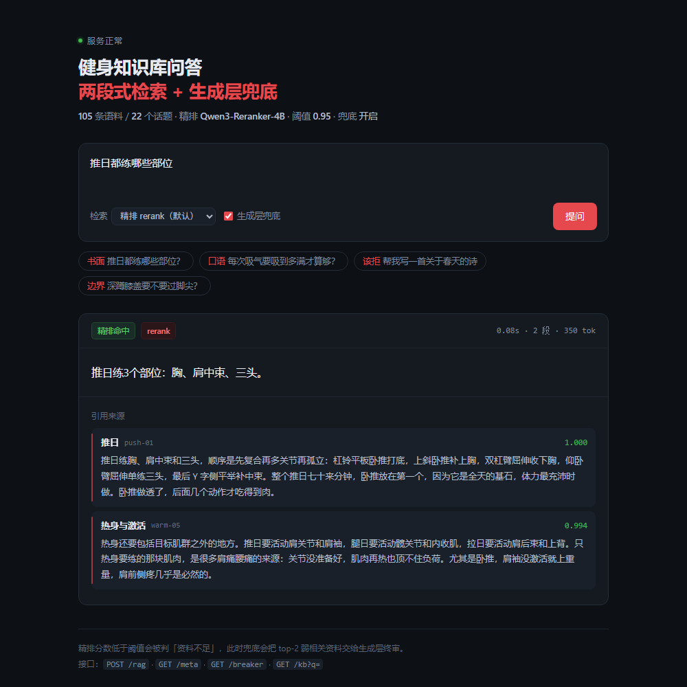
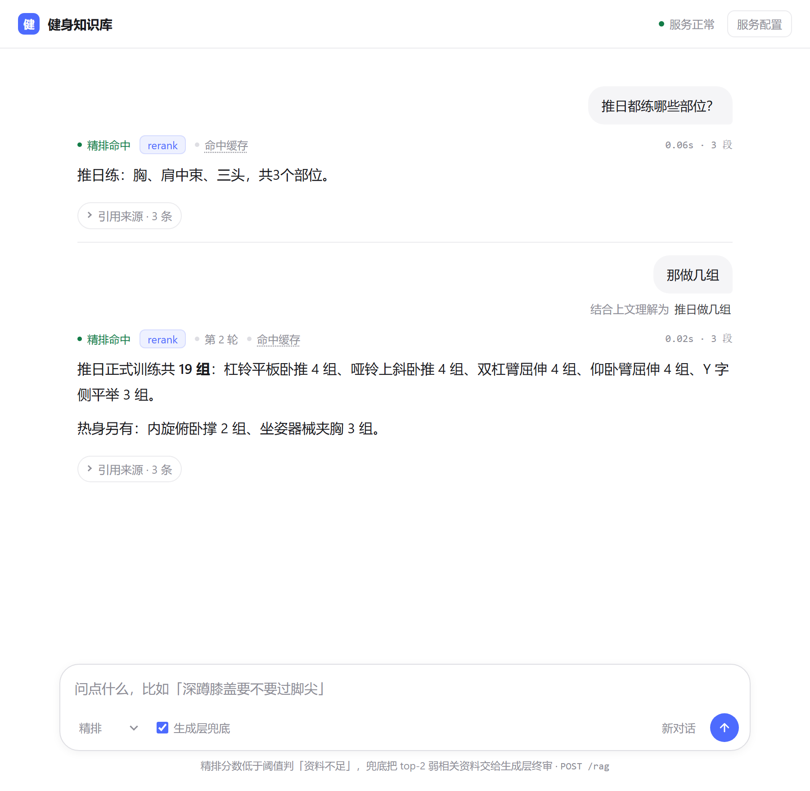
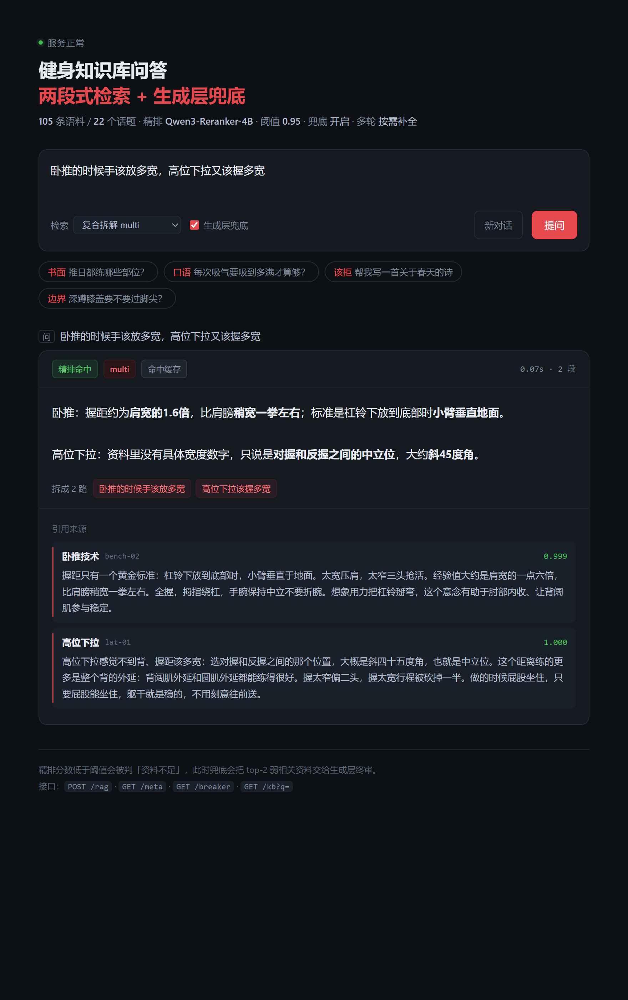
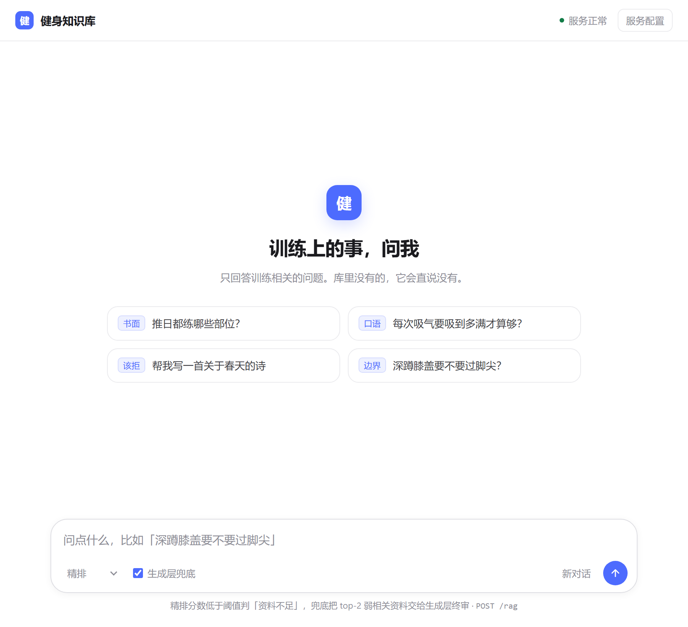

# hello-ai



一个基于 FastAPI 的 AI 应用练习项目。从零实现一套最小可跑的 RAG 闭环：向量检索知识库 → 组装 prompt → 调用大模型 → 带来源返回答案。

知识库是 128 条健身训练资料，主体来自同一个人：健美冠军谭成义（圈内称谭指）的公开教学体系。覆盖三分化（推、拉、腿）、胸部三模块（上胸 / 中胸 / 下胸与中缝）、肩部五步法、腿部跟练、背训细节、训练参数、新手答疑。后续按公众号真实提问补了减脂、减脂饮食、有氧三个话题（105 → 112 → 118 → 119 → 128），其中「减脂吃什么」这类生活化问法直接来自账号本人的口述，理由见「按真实提问补库」一节。上一版 126 条的拼凑语料已经整体替换，理由见「语料重建」一节。

## 快速开始

三种起法任选一种。前置条件只有一个：`.env` 里填上 `LLM_API_KEY`（硅基流动，注册送的额度够跑几千次问答）。

**一、Docker（最省事，不用装 Python 和 uv）**

```bash
cp .env.example .env       # 填入 LLM_API_KEY
docker compose up --build
```

打开 `http://127.0.0.1:8000`。key 通过 compose 的 `env_file` 注入，不进镜像层（`.dockerignore` 里也显式排掉了 `.env`）。

**二、一键脚本（本机已装 uv）**

Windows 双击 `start.bat`；macOS / Linux 跑 `./start.sh`。脚本会检查 `.env` 是否存在、`uv` 是否安装，缺哪样就提示补哪样。

**三、手动**

```bash
uv sync
cp .env.example .env
uv run uvicorn main:app --reload
```

起来之后有三个入口：

| 地址 | 用途 |
| --- | --- |
| `/` | 演示页：单页 HTML + 原生 JS，不引外部 CDN，容器里断网也能打开 |
| `/docs` | FastAPI 自动生成的 OpenAPI 调试页 |
| `/meta` | 当前实际配置（模型名、阈值、语料条数、兜底开关） |

演示页可以直接切换检索模式（`rerank` / `vector` / `oral` / `multi`）和开关生成层兜底，用来现场对比同一个问题在不同链路下的差异。拒绝回答的题会显示灰色的「资料不足」，走兜底救回来会标黄「生成层兜底」；`multi` 模式会额外显示「拆成 N 路」和拆出来的子问题。

## 接口

| 方法 | 路径 | 说明 |
| --- | --- | --- |
| GET | `/` | 演示页（`static/index.html`），静态目录缺失时退回 JSON |
| GET | `/meta` | 当前配置：模型、阈值、召回条数、语料条数、兜底开关 |
| GET | `/greet/{name}?city=` | 路径参数与查询参数示例 |
| POST | `/ask` | Pydantic 数据校验示例 |
| GET | `/kb?q=` | 只做检索（关键词版），返回命中的知识条目 |
| POST | `/chat` | 直接调用大模型，无参考资料 |
| POST | `/rag` | 请求体可带 `session_id`（多轮）。带的话返回会多 `resolved_question` / `condensed` / `history_turns` / `timings`；不带则行为与单轮完全一致 |
| GET | `/session/{sid}` | 看某个会话记了什么（轮次、每轮的原话与被理解成的样子） |
| DELETE | `/session/{sid}` | 清空一个会话（页面上的「新对话」按钮用它） |
| POST | `/rag?mode=rerank` | 向量召回 + reranker 精排 + 生成，**默认模式**（200 题：hit@1 92.8%、答案进上下文 95.9%、拒答 80.6%、整体 86.5%；135 条口语集：92.7% / 96.4% / 拒答 100% / 整体 94.1%。口径见「口径拆解」一节）。返回体带 `uncertain`：判定离门线 < 0.006 时为 true，表示这次判定可能翻面 |
| POST | `/rag?mode=vector` | 纯向量检索 + 生成（整体 67%、拒答 49%） |
| POST | `/rag?mode=hybrid` | 向量 + BM25 混合检索 + 生成（v2 语料上与纯向量**结果完全相同**，见下文） |
| POST | `/rag?mode=rewrite` | 先把口语问题改写成 3 条资料风格表述再检索 + 生成（+1 条，成本翻倍，不设默认） |
| POST | `/rag?mode=oral` | 口语改写 + 精排级联：原问法拒答后才改写（135 条口语集：命中 95%、拒答 60%、整体 88%，比基座低 6 点，不设默认） |
| POST | `/rag?mode=keyword` | 关键词检索 + 生成，用于对照实验 |
| POST | `/rag?mode=multi` | 复合问题：先拆成 2 条子问题各查各的，再融合取 4 条（35 题：覆盖率 90.1%、全中 81.5%；比单路 4 条只高 2.5 点，**不设默认**，见下文） |
| GET | `/breaker` | 熔断器状态：每个上游的 closed / open / half_open、连续失败次数、剩余冷却 |
| GET | `/stats` | 上线观测：请求数、缓存命中率、被限流次数、真实上游调用数、今日已用额度 |
| GET | `/queries` | 真实问法日志，**要口令**。`refused=1` 只看知识库没接住的（选题清单），`fmt=jsonl` 导出原始行 |

## RAG 是怎么实现的

`/rag` 做四件事：

1. **检索（两段式）** —— 先用向量宽松召回 12 条候选（只求不漏，不求准），再用 reranker 对每条候选打分精排，低于 0.50 的丢掉，剩下的按话题去重取 1–3 条
2. **组装** —— 把命中条目拼成【资料】区块，和用户问题一起塞进 prompt
3. **生成** —— 调用大模型，system 里约束「只能依据资料回答，资料没提到的直接说没有」
4. **返回** —— 答案 + 本次用到的资料（含 `id`、`topic`、`source`、`score`）+ 全部候选的精排分数排名

为什么要两段：单靠向量，12 条候选里的正确项常常排在后面（hit@2 只有 92%）；单靠 rerank 没有候选池可排。两段之后 hit@2 到 99%，**候选池里基本一定有答案，剩下的是排序和判别**。

三种行为都有明确处理：

| 情况 | 行为 |
| --- | --- |
| 检索命中且资料能回答 | 依据资料作答，返回 `sources` |
| 检索命中但资料没提到 | 回答「资料里没有这部分内容」，不编造 |
| 分数全部低于阈值 | 直接拒答，**不调用模型**（`tokens` 为 0） |

> 第三行是检索那道闸。第二行是生成那道闸。**两道闸是分开的**，实测有用：肌酸那条被检索放行（0.527 > 0.50），生成层拿到资料发现没有肌酸，照样拒答。所以检索口径的拒答率是 90%，端到端是 100%。

## 容量与成本：数据量小，不代表不知道量大了会怎样

四个脚本，各自回答一个「面试官一定问、但代码里看不出来」的问题。
完整分析见 [`docs/capacity_report.md`](docs/capacity_report.md)。

| 脚本 | 回答什么 | 关键数字 |
| --- | --- | --- |
| `bench_scale.py` | 10 万条文档怎么办 | 逐条 Python 算余弦 10 万条 **43.7 秒**，矩阵乘 **66.8 毫秒**，快 655 倍 |
| `cost_report.py` | 一次提问花多少钱 | 每条 rerank **2097 token**、生成 425 token；按示例价约 ¥0.0023/次 |
| `ab_thinking.py` | 思维链该不该关 | 关掉省 62% 时间、86% 输出 token，但**答案里的数字少一半** |
| `check_static.py` | 数据与代码有没有不同步 | 改了 `kb.json` 忘重建向量会在 30 毫秒内被抓出来 |

两件据此做掉的改动：

1. **检索从逐条循环改成矩阵乘**。`cosine()` 原来在 `for d, v in zip(KB, vectors)` 里一条条算，
   119 条时 57 ms，被后面 LLM 的 3 秒盖住，看起来没问题 —— 但它是全链路里唯一
   会随数据量线性爆炸的环节。改成「预归一化矩阵 + 一次点积」后，10 万条 66.8 ms。
   numpy 是可选的，没装自动退回原实现。改完做了三层核对（数值误差 1e-6、top-12 集合一致、
   200 集指标逐位不变），因为「快但算错」是这类改造最容易踩的坑。
2. **CI 里加离线自检**（`.github/workflows/ci.yml`）。这个项目最贵的错误不是代码写错，
   是数据与代码不同步：改了知识库忘了重建向量，服务不报错，只是答案莫名不对。
   自检把这类问题在 push 时拦下来，顺带检查评测集的 gold 话题是否还存在、
   正文是否违反文风约束、常量是否在合理区间。

**没有做、也想清楚为什么不做的事**：造 10 万条假健身内容。
一问来源就崩，而且假语料会把检索质量带下去。数据量这个短板，正确的补法是把
「真实语料补厚」（靠账号本人口述，见下一节）+「规模化代价量清楚」（靠上面两个脚本），
不是把条数刷上去。

---

## 知识库：128 条 chunk

主体是同一个人的教学体系（下面记的是 v2 重建时的 105 条基线，之后按真实提问补了 13 条，见「按真实提问补库」）。

知识库不在代码里，在 `kb.json`。每条是一个 chunk：

```json
{
  "id": "bench-03",
  "topic": "卧推技术",
  "text": "卧推的触胸点落在下胸边缘、胸骨下沿，大概比乳头线再低一根手指……",
  "source": "谭成义 胸部分化"
}
```

四个字段各有用途，不是随便加的：

| 字段 | 作用 |
| --- | --- |
| `id` | chunk 的唯一标识。评测缓存、rerank 缓存的 key 都用它 |
| `topic` | 所属话题。**评测按话题判命中**，不按 chunk 判——一个话题可能有多条 chunk，标注只到话题这一层 |
| `text` | 正文，平均 120 字 |
| `source` | 出处，跟着 `sources` 一起返回，让答案可追溯 |

**为什么从代码里拆出来。** 一百多条正文塞进 `.py` 会让代码没法看，而且改内容不该动代码。拆出来之后，改知识库不需要碰 `main.py`，格式错了会在启动时立刻报错，这比运行时才炸好。

**为什么每条只写 120 字左右。** 一个 chunk 应该是一个能单独回答一个问题的最小单元。120 到 180 字刚好是一个完整答案；写到 400 字会把两三个子问题挤进一个块，向量被多个主题摊薄，检索反而更模糊。旧库从文章切出来的块平均 190 字，新的手册式内容压到 120 字，是因为「一个动作一个要点」本身就比「一段叙事」短。就横向加条数，纵向保持密度。

**一个话题有多条 chunk 时怎么选。** `pick_hits()` 做了两件事：先按阈值过滤，再**按话题去重**，同一个话题只留分最高的那条。不加去重的话，用户问「卧推手肘打开多少度」，top2 可能全是「卧推技术」的两条，把上下文占满，真正该答的「上胸角度」挤出局。多样性比同质的高分更值钱。

**主题句决定精排生死。** 5 条 chunk 的开头被改成了「用户会问的样子」：

```
改前：这套计划能练多久：…          （问「练了两个月不涨了」→ 精排给 0.32）
改后：练了几个月突然不涨了、重量上不去怎么办：…（→ 0.96）
```

rerank 判断的是「这段能不能回答这个问题」，它第一眼看开头。开头写的是资料的目录名而不是用户的问题，正文写得再好也可能被埋掉。细节和代价见下文「换个方向：改 chunk 的主题句」。

## 语料重建：把倾斜修掉

这一节记的是 v1 → v2 的整体替换，因为它是整个项目里唯一一次「问题不在代码、也不在参数」的修复。

### 旧库的问题：一个话题占了四成

```
旧库 126 条 / 15 个话题
  减脂      50 条  39.7%
  胸肌      13 条  10.3%
  深蹲      11 条   8.7%
  ...
  卧推       1 条   0.8%
  硬拉       1 条   0.8%
```

减脂一个话题四十条，卧推和硬拉各一条。这个分布不是设计出来的，是「缺什么补什么」攒出来的：减脂内容最好写、也最容易从文章里切，于是一路滚到五十条；卧推硬拉难写，就一直只有一条。

**后果不是「减脂答得太多」，而是「该答的被挤掉」。** 向量检索是在全库里比相似度，一个话题占四成，它的 chunk 就有四成的概率出现在任何 top_k 的候选里。「增肌期要不要做有氧」被拉去「减脂」，「卧推胸没感觉」找不到「卧推」——这两条错例在混合检索、query 改写两轮实验里反复出现，换了三种排序算法都修不好。

前面试过的所有手段（阈值调整、BM25 融合、reranker、query 改写）都是在**排序**上做文章。可如果正确答案压根没进候选池，排序再准也没用。这就是为什么那四轮实验的收益始终在 ±1 条题上打转。

### 新库：同一个人、同一套体系、22 个话题平铺

```
新库 105 条 / 22 个话题 / 12663 字 / 平均 120 字
  卧推技术      7 条  6.7%
  背训技术      7 条  6.7%
  训练参数      7 条  6.7%
  肩部训练      6 条  5.7%
  新手上路      6 条  5.7%
  推日/上胸/下胸与中缝/拉日/腿日/热身与激活  各 5 条  4.8%
  中胸/绳索夹胸/高位下拉/侧平举/深蹲/硬拉/单腿训练/腿部孤立/分化与频率  各 4 条  3.8%
  后束/饮食配合  各 3 条  2.9%
```

最大话题从 39.7% 降到 6.7%，最大最小比从 50:1 降到 7:3。

**为什么是「一个人的体系」而不是「更多人的内容」。** 语料不只是事实的集合，它还是一套术语和因果链。谭成义的体系内部是自洽的：后束先行、先质量再重量、手肘先动、离心三秒、RPE 8——这些原则在胸、背、肩、腿四个部位反复出现，检索时同一个问题的不同问法都能落到互相呼应的 chunk 上。混十个博主的说法，会出现「A 说深蹲要蹲到底、B 说蹲到平行就停」这种互相抵消的语料，模型答起来必然摇摆。

**内容怎么来。** 不是逐字复制，是按主题重写成陈述句，`source` 字段标清是哪个系列：

| 来源 | 覆盖的话题 |
| --- | --- |
| 谭成义《三分化训练》推日 / 拉日 / 腿日 | 推日、拉日、腿日、分化与频率 |
| 谭成义 胸部三模块（上胸 / 中胸 / 下胸与中缝） | 卧推技术、上胸、中胸、下胸与中缝、绳索夹胸 |
| 谭成义 肩部体系（后束先行 + 五步法） | 肩部训练、侧平举、后束 |
| 谭成义 腿部跟练（热身三步 + 四个动作及变式） | 深蹲、硬拉、单腿训练、腿部孤立 |
| 谭成义 背训（高位下拉、肩胛被动、手肘先动） | 背训技术、高位下拉 |
| 谭成义 名词释义与新手答疑 | 训练参数、新手上路、饮食配合、热身与激活 |

**构建脚本而不是手改 JSON。** `build_kb_tan.py` 里是全部 105 条，跑一次校验三件事再写文件：id 不撞号、正文不重复、长度落在 100 到 300 字之间。三条都不是洁癖——正文重复会让两条互相抢 `top_k` 名额，等于凭空少一个位置；太短的块会被 0.60 的阈值直接卡掉，等于这条语料不存在。实际写的时候，校验器当场拦下了 3 条不足 100 字的。

它同时打印分布表。**倾斜这件事必须有数字**，不然「均衡了」只是感觉。

### 按真实提问补库：105 → 128

自测分数再高，也要拿真实提问验一遍。公众号上线后拉了 17 条粉丝提问，5 条没接住。核对语料：**「减脂」在这 105 条里出现 0 次，「有氧」0 次**——22 个话题全是增肌和力量训练，`饮食配合` 那 3 条讲的还是「增肌要热量盈余」。所以 5 条落空全部是「库里没有」，没有一条是「库里有但没检索到」，和四桶分解里 miss=0 的结论对得上。

补库分两轮，来路不一样：

| 轮次 | 补了什么 | 来路 | 条数 |
| --- | --- | --- | --- |
| v3 | 减脂 3 / 减脂饮食 2 / 有氧 2 | 从账号自己发过的三篇文章（《增肌减脂的底层逻辑》《3 倍碳水减脂》）提炼 | 105 → 112 |
| v4 | 减脂饮食 6（蛋白 / 不该吃 / 碳水 / 脂肪和菜 / 三餐 / 外卖） | **账号本人语音口述**，逐句录，不是二次改写 | 112 → 118 |

v4 的起因值得单独记：真实提问「减脂期间，推荐吃什么呢」精排 **0.9524**，刚好压在 0.95 门槛上；本地重跑同一句话只有 **0.9481**，直接拒答。查下去发现库里只有克数（碳水 2.5~3 倍体重、蛋白 1.5~2 倍），**没有一句「具体吃什么」**——模型判「资料不足」是对的，线上那次答了反而更可疑。补完 6 条食物清单后，同一句话 **0.9980**，离开门槛 0.05。

这件事顺带暴露了一个更普遍的问题：**精排分本身会抖**。同一句话重跑 5 次，极差 0.0007~0.0055。也就是说分数落在门槛 ±0.02 内的题，答/拒取决于这一次调用，不是能力结论。所以 `analyze_queries.py` 现在单独列一个「踩线区」，把这类题揪出来，别拿抛硬币的结果当指标。

口径上的一个坑：补完内容后，评测集里 10 条减脂题从「库外」变成了「库内」，固定标签还写着「应拒答」，于是拒答率从 81.0% 掉到 71.8%。**这不是退步，是标签过期**——负例清单本来就会随语料增长而过期，得定期改判，否则越补内容分数越难看。

按实测改了 6 条（精排 0.997~0.999 且落到对的话题：空腹有氧 / 蛋白要吃更多 / 每天吃多少卡 / 保住力量 / 要不要做力量训练 / 会不会掉肌肉），另外 4 条仍拒得对（碳水循环 0.73、HIIT 0.36、局部减脂 0.31、一周减几斤 0.90）。改判后 200 集：**hit@1 93.3% / hit@2 95.2% / 拒答 76.3% / 整体 85.0%**（改判前 92.8 / 94.8 / 71.8 / 82.0）。

改判要留备份（`eval_cases.json.bak-20261124`），每条 note 写清分数和理由。否则过两周没人知道「为什么这条从拒答变成了应答」，改判就成了刷分。

### 代价：有些问题现在会拒答

替换是彻底的，所以减脂、肌酸、蛋白粉、有氧、康复这些话题一条都不剩了。现在的知识库只讲力量训练技术，问「减脂期怎么吃」会得到「知识库里没有相关资料」。

这是用户明确要求的取舍——语料要纯，就得接受覆盖变窄。但要说清楚它意味着什么：**公众号那边如果再发减脂类文章，知识库答不了**。补的办法是从同一个体系里找对应内容（谭成义很少讲减脂，这部分基本靠新的内容源），而不是把旧库塞回来——那等于把倾斜也一起塞回来。

## v2 语料上的五路对比

新语料、新评测集（200 条：95 应命中 + 105 应拒答），全部重测。

```
uv run python eval.py
```

| 方案 | hit@1 | hit@2 | 拒答正确率 | 整体准确率 |
| --- | --- | --- | --- | --- |
| 关键词 | 32%（30/95） | 32%（30/95） | 84%（88/105） | 59%（118/200） |
| 纯向量（0.60） | 87%（83/95） | 94%（89/95） | 49%（51/105） | 67%（134/200） |
| 混合（BM25 加权） | 87%（83/95） | 94%（89/95） | 49%（51/105） | 67%（134/200） |
| query 改写 | 88%（84/95） | 96%（91/95） | 50%（52/105） | 68%（136/200） |
| **rerank（0.50）** | **95%（90/95）** | **99%（94/95）** | **75%（79/105）** | **84%（169/200）** |

**先泼一盆冷水：这组数不能和 v1 直接比。** v1 是 92%，纯向量这里是 67%，但评测集从 87 条换成了 200 条，题目也全换了。换题库前后的百分比没有可比性，只能当各自语料的成绩单看。

**第二盆冷水：拒答率那一列不能单看。** 关键词的拒答率 84% 看着比纯向量的 49% 漂亮得多，但它的 hit@1 只有 32%——因为它几乎什么都命中不了，拒答率高是「不识字的副作用」，不是判别力。**拒答率必须和 hit@1 一起读**，否则「全部拒答」会拿到 100% 的最佳成绩。

**第三盆冷水：hit@1 这一列本身也是乐观的。** 它的口径是「排第一的 topic 对不对」，**不考虑这个分数过不过阈值**。一条题排在第一位、分数 0.32、实际会被拒答，在 hit@1 里仍算对。

200 条题在自洽口径下（过了阈值才算答对）rerank 是 hit@1 92.6%、拒答 74.3%、整体 83.0%——比表里的 95% 低 2.4 个点。这个差额就是「排序对了但没答出去」的那部分。**看检索质量用 hit@1，看用户拿到什么必须用端到端**（见下文「端到端才是真指标」）。

能比的是**同一批题上新旧语料的差距**——而这件事没法做，因为旧语料答不了新题（问「卧推六步」旧库只有 1 条卧推，必然拒答），新语料也答不了旧题（问「肌酸」新库一条都没有）。这是替换语料的固有代价：**基线断了，只能重开一条**。

### 换语料把结论整个翻过来了

v1 上 rerank 是**不采用**的（整体 90% vs 纯向量 92%），改写是**净收益 0**（92% vs 92%）。v2 上两个都翻了：

| 方案 | v1（126 条拼凑语料） | v2（105 条单一体系） | 结论变化 |
| --- | --- | --- | --- |
| rerank | 90%，拒答 80% | **95%，拒答 75%** | 从「不用」变成**默认** |
| 改写 | 92%，拒答 90% | 88%，拒答 50% | 从「净收益 0」变成「略好但仍不用」 |
| 混合 | 93% | 87%（与纯向量**完全相同**） | 从「+1 条」变成「一次没生效」 |

**这不是前后矛盾，是参数和方案都绑在语料上。** v1 是十来个来源拼起来的：说法互相打架、术语不统一、同一件事四五种写法，所以向量找不准，reranker 也判不出来（「膝盖半月板损伤」和「深蹲」语义近，但深蹲那条没写康复）。v2 只有一个人的体系：术语统一、因果链自洽，检索和精排同时变准。

三个必须说清的细节：

**一、混合检索在 v2 上一次都没生效。** 数字和纯向量**每个小数位都一样**。不是 bug——`HYBRID_ALPHA = 0.93`，BM25 只占 7%，而单一体系语料里字符 bigram 的区分度本来就低，融合后排序一条都没动。v1 上它是 +1 条（修好 2 条、弄坏 1 条），那点收益在 v2 上直接归零。

**二、改写赢了 1 条，但仍然不设默认。** 88% vs 87%，hit@2 96% vs 94%。这是 v1 上没出现过的情况（v1 里改写等价于把阈值降到 0.58，匹配拒答率后一次没赢）。但 1 条题在 95 条上的差异不构成结论，而且改写的代价是每题多一次生成 + 4 条向量化，成本翻倍。它还带来一个 v1 没有的坏例子：「帮我写一首诗」被改写成健身问题，**反而命中了「推日」**——改写器总想把问题往知识库方向拉，对拒答是净负作用。

**三、rerank 赢的不是排序，是判别力。** hit@2 是 99%，说明候选池里本来就有答案（12 条召回里），是排序没把它们提上来。但真正拉开差距的是拒答率：75% vs 49%，差 26 个点。reranker 的分数能把「该答的」和「该拒的」切开，余弦相似度切不开。**这是 v2 语料带来的，不是 reranker 本身变强了。**


### 5 条错例：全部是标注口径问题，没有一条是检索失败

rerank（0.50）下 200 条里，命中题答错 5 条。逐条看分数：

| 问题 | 判给 | 分数 | 真相 |
| --- | --- | --- | --- |
| 中位绳索夹胸手往哪个方向夹 | 绳索夹胸 | 0.997 | mid-02 讲的就是中位绳索夹胸 |
| 练背总是找不到发力感 | 新手上路 | 0.968 | newbie-02 原文「总是手臂酸，先把重量减半，专注目标肌肉」 |
| 肩部日动作怎么排 | 后束 | 0.957 | shoulder-04 的五步里第一步就是器械反飞鸟，rear-01 讲得更细 |
| 练肩之前为什么要激活 | 热身与激活 | 0.940 | warm-03 整条都在讲这件事 |
| 卧推练完三头比胸酸正常吗 | 卧推技术 | 0.985 | push-04「说不出来说明涨的其实是三头和前束」 |

**5 条里 0 条是检索失败。** 分数全部在 0.94 以上——检索非常确信自己找到了答案，只是答案挂在另一个话题标签下。一个人写的体系里话题天然咬合：问「中位绳索夹胸」，「中胸」和「绳索夹胸」两条都在答，判成哪个都对。**chunk 世界里有边界，话题标签里没有。**

这段原来是估的（「大概是 5/95 ≈ 5%」）。后来把两套集逐条分桶量了，实测 **3.4%（7/207）**，并且顺带发现了一件比错标更重要的事：**向量召回 12 条里，正例的 gold 话题 100% 都在**——这个项目的检索层一次都没失败过。见下面「口径拆解」一节。

### 26 条误放，按分数分成三段，性质完全不同

回收率靠阈值卡不住的部分，才是真的问题。26 条误放按分数排：

| 分数段 | 条数 | 例 | 能靠阈值拦吗 |
| --- | --- | --- | --- |
| 0.50 ~ 0.60 | 8 | 肌酸 0.531、减脂蛋白 0.544、史密斯 0.538、卧推需要人保护 0.504 | 能，但会连带拦掉同分的真答案 |
| 0.60 ~ 0.78 | 8 | 腹肌 0.642、后束练不大 0.713、网球肘 0.678、硬拉腰酸 0.625 | 勉强，代价开始大 |
| **0.78 以上** | **10** | 上斜哑铃怎么起铃 0.963、深蹲和腿举 0.955、肩部一周练几次 0.920、肩袖损伤 0.918、推举肩膀疼 0.870… | **拦不住** |

**最后一段是这轮最重要的发现。** 10 条误放的分数比一半正样本还高。要把它们拦下来，阈值得提到 0.97 以上，那时候 hit@1 会从 95% 掉到个位数。

为什么分这么高？因为它们**字面上就在问同一个动作**——「上斜哑铃怎么起铃」和 upper-02「上斜首选哑铃，能多下三到五厘米」，reranker 看到的是「上斜 + 哑铃 + 怎么用」，判定强相关，但它没回答「怎么起铃」。这是「语义近邻 ≠ 能回答」的加强版：**连主题都相同，只是缺那个具体步骤。**

所以这 10 条不是参数问题，是**内容缺口**。修法只有一条：补内容。它们现在留在评测集里的价值，是当作一份「语料该往哪儿扩」的清单。

### 补拒答样本：34 → 105

34 条拒答题给出的拒答率，95% 置信区间还有 ±11 个点（n=34、比例 0.8 时）。拿这个精度去定阈值的小数位没有意义。所以扩到 105 条。

**关键不是数量，是分层。** 只补「完全无关」的题（写诗、天气、股票）没有用——它们分数都在 0.25 以下，对阈值毫无影响。真正决定阈值的是**邻近难例**：问同一个动作，但库里没答那个点。

| 层 | 是什么 | 条数 | 例 |
| --- | --- | --- | --- |
| A | 完全无关 | 16 | 今天杭州天气、明天A股会涨吗、考研数学怎么复习 |
| B | 健身领域但整块缺失 | 50 | 氮泵、生理期练腿、肩袖损伤怎么练、一天吃几餐、五十岁还能练吗 |
| C | 邻近难例 | 44 | 卧推起桥算作弊吗、硬拉握力不够、深蹲膝盖响、臀推怎么练 |

C 层是重点，每条都写清了「库里的哪个 chunk 差在哪一步」。比如「深蹲蹲不下去怎么办」标的是：legs-04 有髋部热身（青蛙趴、泡沫轴转髋），但没针对下蹲受限的成因（踝背屈、髋屈曲）。

**样本不能靠「我觉得库里没有」来标。** `probe_refuse.py` 先算真实精排分，过 0.75 的强制人工复核原文。两轮下来抓出 **7 条我自己标错的**：

| 我本想标成拒答 | 精排分 | 复核结论 |
| --- | --- | --- |
| 硬拉每次都要从地面拉起来吗 | 0.9227 | **答了**。dead-01「它不是把杠铃从地上拉起来，而是靠屈髋把重量送下去」 |
| 侧平举用多重的哑铃 | 0.6309 | **答了**。lateral-02「控制得住的重量才叫有效重量」是完整教练答案 |
| 卧推每次都要触胸吗 | 0.9863 | **答了**。bench-03 给触胸点，param-07 给必要性「半程只有六成效果」 |
| 卧推练完三头比胸酸正常吗 | 0.9851 | **答了**。push-04「说不出来说明涨的是三头和前束，该退回去减重量」 |
| 划船腰疼怎么办 | 0.8788 | **答了**。back-05「组做完先感觉到腰，说明重量超了或躯干在动」 |
| 四分化比三分化好吗 | 0.9324 | **答了**。split-01 讲三分化的坏处是「对频率要求高的人不够」 |
| 深蹲重量上不去怎么办 | 0.8282 | **答了**。newbie-05「连续两周加不上重量就是平台期，调整动作顺序」 |

**如果直接写完就标进去，评测集里会多 7 条错的负样本。** 这种污染比少几条样本危险得多——它让「拒答率」这个指标永远修不好，因为系统在因为答对而被扣分。

另有 7 条分数同样很高（0.78~0.96），复核后**确认是真拒答**，而且是最有价值的负样本：库里出现了同样的关键词，但只讲了预防或相邻人群。

| 分数 | 问题 | 为什么算拒答 |
| --- | --- | --- |
| 0.9632 | 上斜哑铃怎么起铃 | upper-02/03 讲选哑铃的理由和推的轨迹，零起铃手法 |
| 0.9548 | 深蹲和腿举哪个好 | squat-01 只有「膝盖痛直接换腿举」这一句替代关系，没比较取舍 |
| 0.9182 | 肩袖损伤怎么练 | shoulder-06 说肩袖压力小、warm-01 说弹力外展改善肩痛——都是预防 |
| 0.9179 | 肩部一周练几次 | shoulder 六条讲日内容，split-01 的频率是全身肌群口径 |
| 0.8698 | 推举肩膀疼 | 命中 rear-03（后束是圆肩肩痛根源），讲的是机理不是动作中的疼 |
| 0.8364 | 臀推怎么练 | reranker 被「臀」「推」骗了，命中 bench-01（卧推六步） |
| 0.7819 | 深蹲蹲不下去怎么办 | 命中 iso-02（腿弯举外旋位），legs-04 只有髋部热身 |

最终 **200 题（95 命中 / 105 拒答）**，三层 A 16 / B 50 / C 44。

### 阈值：最优从 0.50 挪到 0.55，但端到端说不该动

样本一变，扫出来的最优阈值就变了：

| 阈值 | hit@1 | 拒答率 | 整体 |
| --- | --- | --- | --- |
| 0.50（原设定） | 94% | 79% | 90% |
| **0.55（新扫描的最优）** | 93% | **88%** | **92%** |

看着该抬到 0.55：拒答率 +9 个点，只牺牲 1 条 hit@1，整体 +2 点。代价换得很值。

**但这是检索口径的账，端到端一算就翻过来了。**

`e2e_refuse.py` 把 34 条拒答题全部走一遍完整 `/rag`（检索 + 生成），数用户实际拿到什么：

```
拒答题 34 条，阈值 0.50
  检索自己拦下        27/34 = 79%
  检索放行            7/34 = 21%
  端到端守住（含生成层）34/34 = 100%
  → 生成层额外兜住    7 条
```

**0.50 下端到端已经是 100%。** 那 7 条检索放行的题，生成层全部认怂：

| 题 | 检索命中 | 生成层实际回答 |
| --- | --- | --- |
| 肌酸一天吃多少 | 饮食配合 | 「资料里没有这部分内容。」 |
| 腹肌怎么练 | 推日 | 「资料里没有腹肌训练这部分内容。」 |
| 腰突能练硬拉吗 | 硬拉 | 「资料里没有『腰椎间盘突出』能否练硬拉的专门内容。」 |
| 卧推手腕疼 | 热身与激活 | 「资料里没有专门讲『卧推手腕疼怎么办』。」 |

也就是说，0.55 拦下来的那 3 条（肌酸 0.5309 / 减脂蛋白 0.5443 / 史密斯 0.5458），在 0.50 下**用户看到的东西一模一样**。**那 9 个点的拒答率提升，在端到端是零。**

而代价是真的：「哥本哈根支撑」精排分 0.5404，实测有时过 0.55，抬到 0.55 会把它误拒。它是真实问题、legs-05 专门讲了，没有第二道闸补救。

所以**阈值保持 0.50**。理由不是「0.55 不好」，是**不能用错误层级的指标优化系统**：检索拒答率只是阈值开关的统计，真正的守门人是生成层。检索阈值的主要价值是省 token（拦掉就不调模型）和降低幻觉概率，不是「正确率」。

### 反方向也要量：生成层会不会把该答的也拒了

端到端拒答 100% 听着漂亮，但如果代价是「什么都答资料里没有」，系统等于废了。`e2e_hit.py` 抽 20 条检索已经答对的题走完整链路：

```
抽样 20 条该命中的题，生成层误拒 2 条（10%）
```

逐条看，只有 1 条是真误拒：

| 题 | 生成层回答 | 判定 |
| --- | --- | --- |
| 侧平举为什么总是耸肩 | 「资料里没有耸肩原因。只提到顶部负荷最重、最容易借力」 | **真误拒**，lateral-03 讲的就是耸肩原因 |
| 第一次进健身房用多重 | 「从空杆开始…资料里没有空杆的具体公斤数」 | 不算，核心答了，只是诚实说没写空杆重量 |

**真实误拒 1/20 = 5%**（另 1 条的判定标准偏严，它以「资料里没有具体公斤数」结尾，但已经给出了可执行的答案）。

合起来看这个系统的性格：**幻觉 0/34，误拒 1/20。整体偏保守。** 对健身建议来说这是对的方向——答错一个动作要领比不答危险得多。

### 分数会抖，边界题不可靠

同一个问题跑两次，reranker 的分数不完全一样：

- 哥本哈根支撑：离线缓存 0.5404，实时调用有时 >0.55
- 肩峰撞击：探针跑两次 0.8477 / 0.8466，差 0.0011
- 肌酸：离线 0.5309、实时 0.5270，差 0.004

0.004 的抖动足以让一条题在 0.50 和 0.535 之间翻面。这也是不把阈值贴着某个具体分数取的原因——贴着靠不住。

### 交叉验证：最优点在移动

在评测集上扫最优阈值，本质是拿测试集当训练集。五折，每次用 80% 选阈值，在剩下 20% 上验证：

| 折 | 训练集独立选出 | 留出集 |
| --- | --- | --- |
| 1 | 0.550 | 88% |
| 2 | 0.400 | 92% |
| 3 | 0.535 | 88% |
| 4 | 0.550 | 80% |
| 5 | 0.550 | 100% |

选出阈值 `[0.55, 0.40, 0.535, 0.55, 0.55]`，**极差 0.15**，留出集平均 90%。

和上一轮（10 条拒答样本时，4/5 折收敛到 0.540、极差 0.10）比，样本变多之后最优点的移动范围反而更大了。原因不是样本噪声，是**新加的 C 层难例把分数分布往两边拉宽了**——这正是它们存在的意义。

## 试过 doc2query：做了、量了、不启用

「同义换措辞」这个病是诊断出来的，不是猜的。`diag_lowscore.py` 扫 95 条命中题，低于 0.55 的只有 3 条，而且 **100% 是「向量召回捞到了、精排给了低分」，召回失败 0 条**：

```
0.2866  向量第 6 名  深蹲重量上不去怎么办     -> 新手上路
0.3222  向量第 1 名  练了两个月不涨了怎么办   -> 新手上路   ← 向量排第 1
0.5404  向量第 1 名  哥本哈根支撑有什么用     -> 腿日
```

「练了两个月不涨了怎么办」的向量排名是**第 1**，正确答案就在召回池最前面，rerank 只给 0.3222。召回是无辜的，问题在精排。

所以第一反应是 Doc2Query：给每条 chunk 生成「用户会怎么问」，拼进精排的候选文本，让 reranker 同时看到正文和问法。

**第一步就翻车。** 第一版 prompt 让模型「用口语」，它理解成了方言土话：

```
这个举法一回弄几个总共整几组啊
两只手各拿一个铁疙瘩举上去怎么往一块凑
```

真实用户不会这么说话。这些噪声词只会干扰精排。重写 prompt（明确「不要方言土话，哑铃就叫哑铃」）之后才正常：

```
练胸肩三头那天都练啥？
卧推为啥要放最前面？
练久了重量上不去该怎么调整？
```

105 条全部生成（`kb_queries.json`，平均 4 个）。然后 A/B，两个配置各自扫自己的最优阈值——**不开不行，分数刻度变了，用同一个 0.50 比是拿新刻度套旧尺子**：

| 配置 | hit@1 | hit@2 | 拒答率 | 整体 |
| --- | --- | --- | --- | --- |
| doc2query 关（阈值 0.50） | **92.6%** | 91.6% | 74.3% | 83.0% |
| doc2query 开（阈值 0.50） | 88.4% | 95.8% | 86.7% | 87.5% |
| 开，阈值 0.45 | 88.4% | — | 81.0% | 84.5% |

**整体准确率涨了 4.5 个点，但 hit@1 掉了 4.2 个点。** 这不是成功——整体那个数字是「拒答换命中」换来的：多拦了 13 条错答，多拒了 4 条真答案。

而上一轮已经验证过：**放行的错答，生成层本来就会兜住**（34 条拒答题端到端 100%）；被检索拦掉的真答案，没有第二道闸会救它。所以那 13 条是零收益，那 4 条是纯损失。

再补一个口语集（24 条纯口语问法）验证，也只 +1 条（66.7% → 70.8%）。

**判定：不启用。** 代码和 `kb_queries.json` 都留着，开关在 `USE_DOC2QUERY`，换更强的 reranker 或语料翻几倍后值得重测。

## 换个方向：改 chunk 的主题句

### 但改主题句有副作用，必须回头查

第一版把 upper-01 的开头写成「上斜卧推的**凳子**该调多少度」，结果把「器械推胸**座椅**调多高」这条题从中胸拉到了上胸（0.789 → 0.916，答错了）。**新词引入了新的字面重叠。**

换成「上斜卧推**要翘多少度**」——避开「凳 / 座椅」——副作用消失，原来那两条仍在 0.99。这个教训是一次性的：**改完必须把相邻话题的题全跑一遍，不能只看目标题涨没涨。**

### 为什么这个方案比 doc2query 好

| | doc2query | 改主题句 |
| --- | --- | --- |
| 改动范围 | 105 条全部 | 5 条 |
| 精排输入长度 | +50%（稀释正文） | 基本不变 |
| 综合集 hit@1 | −4.2 点 | **+1.0 点** |
| 口语集 hit@1 | +1 条 | **+3 条** |
| 副作用 | 分数整体下移，边缘正样本被推下去 | 一条题 −0.11（仍安全） |

根因是**「主题句是否对着用户说话」**，doc2query 是在外围补救，改主题句是直接修根因。这也解释了为什么 doc2query 会让分数整体下移：它在每条 chunk 后面加了一段「问法」，而问法的语义密度低于正文，等于把正文稀释了。

## 第二轮：问法里少了「减脂」两个字（2026-11-24）

线上真实提问里出现两条「答案就在库里、但是被拒了」：

```
一周减几斤算正常      0.9041  ← lose-01 正文写着「一周掉零点二五到零点五公斤」
坚果一天吃多少        0.8618  ← diet-food-04 正文写着「坚果一小把」
```

第一反应是「量化类问法（几斤 / 多少克 / 几次）reranker 不认」。扫了 12 条量化问法和 12 条同内容非量化问法配对，**假设当场被推翻**：量化组 10/12 过线、精排均分 **0.9787**，非量化组反而只有 0.8429，配对差中位数 +0.0002。第二个假设「库里是中文数字、用户打阿拉伯数字」也推翻，8 条阿拉伯数字问法 8/8 全过线。

真因靠「长度相同、只差两个字」这组对照才定下来：

| 问法 | 字数 | 精排 |
| --- | --- | --- |
| 坚果每天吃多少才算够 | 10 | 0.9146（拒） |
| 减脂坚果每天吃多少够 | 11 | **0.9951**（过） |
| 七天掉几斤才算正常 | 9 | 0.6276（拒） |
| 减脂七天掉几斤算正常 | 10 | **0.9857**（过） |

长度几乎一样，只多了「减脂」。**是缺领域限定词，不是缺长度、不是量化词、不是数字写法。** 库里当时 119 条全是「减脂期…」「有氧…」开头的领域内表述，reranker 靠这些词锚定话题；用户口语提问天然省略主语——粉丝点进来，默认「我现在在减脂」，问的是「坚果一天吃多少」。

接着考虑「查询侧自动补领域词」，被负例对照否掉：

```
肌酸一天吃多少        0.2313 → 减脂期肌酸一天吃多少   0.8715   （+0.64，距门槛只剩 0.08）
我膝盖疼吃什么        0.3201 → 减脂期膝盖疼吃什么     0.5821
```

补词能把库外问题从 0.23 推到 0.87。今天不过线，明天多两条 chunk 就过线了——**这是拒答换命中，和上面 doc2query 是同一个坑**。

所以最终只做一件事：把 3 条 chunk 的主题句改成用户的说法，正文一个字不删（`lose-01`、`diet-food-04`、`diet-food-05`，例如「减脂一周掉几斤算正常、缺口开多大才合适。减脂的直接条件只有一个…」）。

**A/B（新旧两版 kb.json 跑同一批 335 题，逐条比）：正例 hit@1 203/209 = 97.1%，一模一样；判定翻转只有 1 条，就是目标那条（0.9041 → 0.9960），另两条分数下降的都是负例。**

端到端复验里还验证了一件更重要的事：**「中午吃什么」精排只有 0.77，兜底照样答对了**（「一平碗米饭、一掌心大的鸡胸、一大盘绿叶菜」）。而 0.96 过线的「蛋白粉一天喝几勺」，模型自己回「资料里没有…」——没编勺数。`RERANK_TOP_K=3` 那一节留下的判断在这里第二次被证实：**门槛是硬的，兜底是软的；放行的错答生成层会兜住，被检索拦掉的真答案没人救。**


doc2query 的思路是「给资料补上各种问法」。回头看那个 0.3222 的案例，发现方向错了：

```
newbie-05 原文开头：这套计划能练多久：
用户实际问的：      练了两个月不涨了怎么办
```

rerank 判断的是「这段能不能回答这个问题」，它第一眼看开头。看到「这套计划能练多久」，判定为「在讲计划时长」，给 0.32——**而正文完整答了这个问题**。

不是缺问法，是**主题句没对着用户说话**。

所以只改开头半句：

```
练了几个月突然不涨了、重量上不去怎么办：这套计划一直练到无法再增加重量为止。…
```

一条 chunk 只改一句话，其他一个字不动（`improve_leads.py`，幂等、可重复执行、校验正文不丢）。5 条的效果：

| 问题 | 改前 | 改后 | 变化 |
| --- | --- | --- | --- |
| 胸练完一点感觉都没有 | 0.2413（第 4 名） | **0.9593**（第 1） | +0.72 |
| 下拉感觉不到背 | 0.2571（第 8 名） | **0.9611**（第 1） | +0.70 |
| 练了两个月不涨了怎么办 | 0.3254 | **0.9624** | +0.64 |
| 胸上沿总是不长 | 0.0787（第 3 名） | **0.5377**（第 1） | +0.46 |
| 哥本哈根支撑有什么用 | 0.5404 | **0.9917** | +0.45 |

**4 条跨过门槛，1 条下降（0.976 → 0.861，仍远在门槛之上）。**

整集效果：rerank hit@1 93.7% → 94.7%，hit@2 97.9% → 98.9%，拒答 74.3% → 75.2%，整体 83.0% → 84.5%。

口语集效果更明显：**66.7% → 79.2%**（hit@2 83.3% → 91.7%）。这个数字比 doc2query 好得多，而改动量是 5 句话。

## 口语评测集：原来的评测掩盖了什么

写这批口语题（`eval_cases_colloquial.json`，当时 24 条，现已扩到 135 条）是因为一个怀疑：评测集的问法是我自己写的，天然偏书面。

结果证实了。**同一个系统、同一批 chunk，书面问法 hit@1 95%，口语问法只有 66.7%**（改主题句后 79.2%）。中间差的那 28 个点，就是真实用户会遇到的。

口语集剩下的 5 条错，人工复核后性质完全不同：

| 问题 | 判给 | 真相 |
| --- | --- | --- |
| 练背永远是胳膊先酸 | 新手上路 0.863 | newbie-02「手臂酸先把重量减半」——**答了**，标注口径问题 |
| 龙门架滑轮调多高 | 上胸 0.427 | upper-04「两个滑轮调到最低」——**答了**，标注口径问题 |
| 重量怎么一点点往上加 | 新手上路 0.362 | newbie-01「能标准完成 12 次就加 2.5 公斤」——**答了**，标注口径问题 |
| 胸下面那条线怎么出来 | 绳索夹胸 0.387 | 下胸与中缝排第一但分数低，会被拒 |
| 蹲完屁股先没劲 | 硬拉 0.184 | 真错，squat-03 犀牛蹲才对该答 |

**5 条里 3 条是标注口径问题。** 这再次说明单话题标注会系统性低估——一个人写的体系里，同一个问题经常能被两个话题的 chunk 回答，标哪个都算对。

这件事的结论不是「评测不准」，而是：**评测集的问法分布，本身就是被优化的一部分**。只测自己写的书面问法，会得到一个偏高的数字，然后在真实用户那里翻车。

### 评测基础设施：一次 402 暴露的两个 bug

跑到 rewrite 模式时上游返回 **402：账户余额不足**，整轮中断。前三个模式是纯本地计算（题目向量和库向量都在缓存里），所以还有数；后两个每跑一次都要真金白银地调接口，只能等充值后再补。

这件事本身修了两个 bug，都不是小事：

1. **402 被包成了 502。** 「上游账户余额不足」报成「上游网关错误」，排障的人会去查网络、去加熔断，而真正该做的是充值——方向完全错。现在 401/402/403/404 一律翻成「我们这边的配置问题」，只有真正的上游故障才给 502。
2. **错误信息里写死「已试 3 次」。** 401 明明只试 1 次就放弃，报成 3 次会让人以为网络真的抖了三次。现在按实际尝试次数报。

还有一个结构问题：`eval.py` 原来只能一次跑完五个模式，最后一个模式失败会把前面四个都废掉。现在支持 `--modes` 单独跑，前三个模式零成本。

但 `--modes` 又引出第二个问题：它是**整体覆盖写**的，只跑两路会把前三路的结果抹掉。这次扫描时就撞上了——`tune_rerank.py` 读 `eval_results.json["vector"]` 直接 KeyError。现在改成合并写入，并且校验 `{题数, 库条数}` 是否一致：**对不上就整份丢弃**，因为把两次不同实验的数字拼在一张表里，比丢数据危险得多。

## 把公众号文章接进知识库（v1 遗留）

> **v2 重建时，这批从文章切出来的块已全部移出知识库**，`import_articles.py` 保留但不再使用。这一节留着是因为里面三个切分坑在任何语料工程里都会再遇到。

手工写的 40 条覆盖了高频问题，但真实用户的问题远比这复杂。更划算的内容源是已有的公众号历史文章——那是长期积累的真实语料，不是凭空造的。

`import_articles.py` 负责把 Markdown 原稿切成 chunk 并合并进 `kb.json`：

```bash
uv run python import_articles.py --dry-run   # 只看切出来什么样
uv run python import_articles.py             # 真的写入
```

**先筛掉不该进库的文章。** 10 篇原稿里排除了 2 篇：《减脂全攻略 · 人设化开头（3 选 1）》是三个写作开头的备选，不是知识；《带货置顶文章》是广告。这两篇放进去，问答时会原样吐推销话术。

**8 篇 → 80 块，平均 199 字/块**，和手工那 40 条（181 字）粒度基本一致。这是刻意的——两种来源的 chunk 必须同粒度，否则检索时会有一方系统性吃亏。

### 三个设计决定

**一、按小节切，不按字数切。** 一小节本来就是一个能单独回答的问题。按 300 字硬切会把「动作要领」切断成两半，两半都答不了问题。具体规则：按 `##` 切，有小节内再按 `###` 切（一个 `###` 就是一个动作），最后才按长度打散。

**二、小节标题留在正文里做前缀。** 切出来是 `三、手臂只是钩子。高位下拉，想象腋下夹着个鸡蛋……` 而不是纯正文。之前验证过「带话题名的文本」命中率高得多，同一个道理。

**三、按 id 去重，脚本可以反复跑。** 同一个 `art01-05` 已存在就跳过，不会把同一篇文章导入两遍。另外还做了一次 3-gram Jaccard 查重（阈值 0.75），防止不同文章里重复的段落被收两遍。

**导入前先查了文章之间的重复度**：8 篇两两 Jaccard 全部低于 10%，说明那 4 篇都写减脂的文章各有侧重，不是同一篇的转载，可以全收。

### 接口那条路：订阅号拿不到已发布列表

原计划是直接调微信接口拉全量历史文章，实测走不通，三个接口都试了：

| 接口 | 结果 | 原因 |
| --- | --- | --- |
| `freepublish/batchget` | `48001 api unauthorized` | 发布能力只有服务号有，认证订阅号无权限 |
| `material/batchget_material` | `total_count: 0` | 历史文章不是走永久素材库发的，是走新版「发布」通道 |
| `draft/batchget` | 成功，`total_count: 1` | 草稿箱能读，但只有 1 篇 |

**唯一从接口拿到的是草稿箱里那篇肩部训练**（《健美冠军都在做的南瓜肩训练》，430 字），切成 6 条、话题设为「肩部训练」——这是手工库和文章库都没有的空白分类。`art09-*` 就是这么来的。其余已发布文章只能靠 Markdown 原稿或公开页面抓取。

这套拉取逻辑封装成了 `pull_wechat_articles.py`，以后往草稿箱放新文章，一条命令就能取回来：

```bash
uv run python pull_wechat_articles.py          # 只列出有什么
uv run python pull_wechat_articles.py --dump   # 导出正文到 .wechat_pull/
```

**这篇 430 字的文章切了 6 条，平均只有 70 字**，比文章库的 190 字短得多。不是切分失误——原文本身句句是操作细节，没有铺垫，压不成更长的块。短块的代价很直观：「面拉」那条只有 42 字时，向量信号弱到被「硬拉」压过去（见错例第七）。

顺带踩了一个坑值得记下来：调 `cgi-bin/token` 一直报 `40164 invalid ip 115.63.70.239 ipv6 ::ffff:115.63.70.239, not in whitelist`，但后台 IP 白名单里明明填着 `115.63.70.239`。原因是本机开着 FlClash 的 TUN 模式（虚拟网关 `198.18.0.1`），所有请求以 IPv4-mapped IPv6 形式发出，微信按 IPv6 比对白名单，IPv4 字符串永远匹配不上。**退出代理后立刻成功。** 强制 IPv4 解析、换物理网卡、改 token 接口都无效，只有退出 TUN 才行。

### 一个副作用：话题分布被拉歪了

| 话题 | 手工 | 文章 | 合计 |
| --- | --- | --- | --- |
| 减脂 | 6 | 44 | **50** |
| 胸肌 | 0 | 13 | 13 |
| 深蹲 | 4 | 7 | 11 |
| 动作技术 / 增肌 | 0 | 8 + 8 | 16 |
| 肩部训练 | 0 | 6 | 6 |
| 训练计划 | 5 | 0 | 5 |
| 蛋白质 | 5 | 0 | 5 |
| 肌酸 / 恢复 / 饮食 / 误区 | 4 / 4 / 4 / 4 | 0 | 4 / 4 / 4 / 4 |
| 补剂 / 卧推 / 硬拉 | 2 / 1 / 1 | 0 | 2 / 1 / 1 |

减脂一个话题占了 40%。后果在评测里能直接看到：「增肌期要不要做有氧」被拉去「减脂」——因为减脂那 50 条里确实有大量讨论碳水和有氧的内容。**这不是 bug，是语料结构的真实反映**：教练的内容本来就集中在减脂上。要修得靠补其他话题的文章，不是调参数。

## 检索方式：向量而不是关键词

**为什么不用关键词匹配。** 关键词判断的是「库里那个词有没有出现在提问里」，所以问「蛋白粉怎么喝」匹配不到「蛋白质」，问「怎么变瘦」匹配不到「减脂」。补同义词只能一个个补，永远漏。扩到 126 条之后这个缺陷更明显：87 条评测集上关键词的 hit@1 只有 38%，大量问题直接拒答。

**现在的做法。** 用 `BAAI/bge-m3` 把文字变成 1024 维向量，再算余弦相似度（`cosine()` 是手写的 8 行代码，没有引入 numpy）。相似度高说明「意思接近」，而不只是「字面相同」。

关键参数：

| 参数 | 值 | 说明 |
| --- | --- | --- |
| `EMBED_MODEL` | `BAAI/bge-m3` | 1024 维，中文效果好 |
| 嵌入的文本 | `话题名：正文` | **带上话题名明显提升命中率**，见下方对比 |
| `VEC_THRESHOLD` | 0.60 | 低于此值视为「资料里没有」 |
| `VEC_TOP_K` | 2 | 最多取两条资料塞进 prompt |
| `RECALL_K` | 12 | rerank 模式下先召回多少条给精排 |
| 向量缓存 | `.kb_vectors.json` | 存本地，避免每次重启重复计费 |

**同一批资料、同一个模型，只改嵌入的文本，效果差 6 倍**（4 条库时测的）：

| 方案 | 蛋白粉怎么喝 | 怎么变瘦 |
| --- | --- | --- |
| 只嵌正文 | 蛋白质 0.532（领先 0.019） | 减脂 0.575（领先 0.024） |
| 正文带话题名 | **蛋白质 0.623（领先 0.121）** | **减脂 0.594（领先 0.056）** |

## 检索评测（v1 语料，126 条）

> **本节所有数字都在 v1 语料（126 条拼凑版）上测得，评测集也是那 87 条。**
> v2 换成谭成义体系后语料整体替换、评测集重建并扩到 200 条（拒答样本从 10 条经 34 条补到 105 条），重测结果见后面的「v2 语料上的五路对比」。
> 保留这一节是因为里面几个结论（向量 vs 关键词、文档语言 ≠ 查询语言、阈值平台）不依赖具体语料，而它们当时的证据只在 v1 上。

评测只测**检索**，不调用大模型——快、免费、每次结果一样。`eval_cases.json` 里 87 条：77 条该命中（标注了正确话题），10 条该拒答（含 5 条「健身相关但知识库没有」的难例）。

| 指标 | 关键词匹配 | 向量检索 | 向量 + BM25 | 向量 + query 改写 | 向量 + reranker |
| --- | --- | --- | --- | --- | --- |
| hit@1（第一条就命中正确话题） | 38%（29/77） | 91%（70/77） | **92%（71/77）** | **92%（71/77）** | 91%（70/77） |
| hit@2（前两条里有正确的） | 39%（30/77） | 95%（73/77） | 95%（73/77） | **97%（75/77）** | **97%（75/77）** |
| 拒答正确率 | **100%（10/10）** | **100%（10/10）** | **100%（10/10）** | 90%（9/10） | 80%（8/10） |
| 整体准确率 | 45%（39/87） | 92%（80/87） | **93%（81/87）** | 92%（80/87） | 90%（78/87） |

复现：`uv run python eval.py`

### 四次扩库的对比：库大 30 倍，准确率没掉

| | 4 条库（46 题） | 40 条库（69 题） | 120 条库（81 题） | 126 条库（87 题） |
| --- | --- | --- | --- | --- |
| 向量 hit@1 | 95% | 93% | 92% | 91% |
| 向量拒答率 | 86% | 88% | **100%** | **100%** |
| 向量整体 | 93% | 93% | **93%** | 92% |

**这是整个项目最值得记的一组数。** 直觉上库从 4 条扩到 126 条，干扰项多 30 倍，准确率应该崩。实际整体从 93% 掉到 92%，只掉了 1 个点，hit@1 从 95% 掉到 91%。

能撑住的原因是两个变化互相抵消：干扰项变多（坏），但每条资料从 40 字的半句话变成 180–200 字的完整答案（好），语义更集中，向量更容易对上。

反过来说，**如果扩库时每条还只写一句话，结果会明显变差。扩库的关键不是数量，是每条内容自己的完整度。**

第三次扩库还带来一个意外：**拒答率从 88% 升到 100%**。减脂那 50 条把「减脂」「碳水」「有氧」这些词的向量空间占得更满了，「膝盖半月板损伤怎么康复」这种问题反而没有一条能过 0.60——原来它靠深蹲那条擦边过线，现在被更细的竞争挤了下去。算运气，但方向是好的：**库越具体，无关问题越难蹭到分。**

第四次（120 → 126 条）只加了肩部一类，整体 93% → 92%，掉的那 1 个点来自一条新加的面拉题，原因见下面第七个错例——**它不是切分问题，是模型分不清「面拉」和「硬拉」**。

### 七个错例（全部保留不删）

| 问题 | 期望 | 实际结果 | 类型 | 原因 |
| --- | --- | --- | --- | --- |
| 怎么变瘦 | 减脂 | 误区 | 排序错 | 「练腹肌能减肚子」也在讲减肚子，语义压过「减脂」 |
| 减脂期要吃多少 | 减脂 | 饮食 | 排序错 | 「减脂期脂肪吃多少」这条把「减脂期 + 吃多少」全占了 |
| 昨天吃咸了今天重了两斤 | 减脂 | 拒答 | 漏召回 | 差一点没过 0.60，是取保守阈值的代价 |
| 推拉腿怎么分 | 训练计划 | 拒答 | 漏召回 | 同上，口语化问法向量没拉起来 |
| 找不到发力感怎么办 | 动作技术 | 拒答 | 漏召回 | **最高分 0.5598，差 0.04**；文章讲的是「沉肩」，用户问的是「发力感」 |
| 增肌期要不要做有氧 | 增肌 | 减脂 | 排序错 | 减脂那 50 条里大量讨论碳水与有氧，把问题抢走了 |
| 面拉拉到哪个位置 | 肩部训练 | 拒答 | 误召回 | **「面拉」和「硬拉」只差一个字，向量把硬拉排第一** |

前两条是话题边界模糊，第三四条是保守阈值的直接成本，第五条是文档语言与查询语言对不上，第六条是语料分布被拉歪，第七条是下面单独讲的那个。

### 第七个错例：「面拉」输给「硬拉」

这是全项目最干净的一个失败样本，因为它指向一个明确的解法。

```
面拉拉到哪个位置
   0.5874  硬拉 deadlift        ← 抢走了
   0.5455  卧推 bench-press
   0.5043  肩部训练 art09-06     ← 真正写面拉的那条，连前二都进不去
```

「面拉」和「硬拉」都是「X 拉」，bge-m3 在这个粒度上分不清。试过两种修法都没用：把面拉和前平举拆成两块（42 字太短，信号更弱，反而更差）；合并成 86 字（回到 0.5043，仍不过 0.60）。**这不是切分能解决的问题。**

换成纯字符 bigram 词频检索，同一条问题立刻对了：

```
面拉拉到哪个位置
   0.0833  肩部训练 art09-06     ← 对了
   0.0714  动作技术 art07-08
```

因为「面拉」这个 bigram 只出现在面拉那条里，硬拉里没有。**向量擅长意思相近，词频擅长字面精确——这正是要做混合检索的硬证据**，不再是「工业界都这么做」这种空话。

### 一个新发现：文档语言 ≠ 查询语言

同一件事换四种问法，结果完全不同：

| 问法 | 最高分 | 命中 |
| --- | --- | --- |
| 动作找不到感觉 | 0.6448 | ✅ 动作技术 |
| 练的时候肌肉没感觉 | 0.6890 | ❌ 恢复（doms） |
| 找不到发力感怎么办 | 0.5598 | ❌ 拒答（差 0.04） |
| 意念口诀怎么用 | 0.5135 | ❌ 拒答 |

文章里写的是「沉肩，想的不是往下压」「髋是折，不是弯」，全是陈述句；用户问的是「找不到发力感怎么办」，是问题句。**两句话指的是同一件事，但字面上一个词都不重合。**

这不是阈值能解决的——降低阈值会让「练的时候肌肉没感觉」错得更离谱（它已经 0.6890 命中 doms 了）。试过的两条路：混合检索（让「发力感」这类词能字面匹配）只多答对 1 条，query 改写净收益 0，两条路的过程都记在下面两节里。

### 阈值扫描：0.40 ~ 0.77 逐档测

`uv run python tune_threshold.py`

| 区间 | hit@1 | 拒答率 | 整体准确率 |
| --- | --- | --- | --- |
| 0.40–0.44 | 93% | 10–25% | 83–86% |
| 0.45–0.51 | 93% | 40–50% | 86–88% |
| 0.52–0.57 | 93% | 70–80% | 90–91% |
| **0.58–0.61（当前 0.60）** | 92–93% | **90–100%** | **91–93%** |
| 0.62–0.64 | 86–90% | 100% | 88–91% |
| 0.70 以上 | ≤65% | 100% | ≤69% |

**0.60 在 126 条库上仍然是最优点**，扩库三次（4 → 40 → 120 → 126）都没把它挪走，说明这个位置是稳的。126 条库上 0.60 和 0.61 都是 92%/100%，平台区就在这一段。

取 0.60 而不是 0.61：0.61 拒答也是 100%、hit@1 却掉到 92%，没有收益。也不用 0.58：拒答掉到 90%，换来 hit@1 多 1 条，不划算。**要提醒的是，10 条拒答样本里差 1 条就是 10 个百分点，这个位置上的阈值差异统计意义很弱，别把它当成精确结论。**

## 试过 reranker（v1 语料，126 条）：三轮都无效

> **先说清楚：这一节是 v1 的结论，在 v2 语料上已经被推翻。** v2 上 rerank 是默认模式，整体 90%、检索口径拒答 79%（纯向量是 53%），比纯向量高 12 个点；端到端拒答 100%。翻案的原因不在 reranker 本身，而在语料：v1 是十来个来源拼的，语义近邻满天飞，精排也判不出来（「膝盖半月板损伤」和「深蹲」都提到膝盖，但深蹲那条没写康复）。v2 只有一个人的体系，同样的问题没有了。**保留这一节是因为「同一个方案换语料后结论反转」本身就是结论。**

阈值这一维调到头，下一步是加 **reranker**（`BAAI/bge-reranker-v2-m3`）做二次排序。它的原理和 embedding 不同：embedding 比的是「两段文字意思像不像」，reranker 比的是「这段资料到底有没有回答这个问题」——后者才对得上「该不该答」。

做法是两段式：向量宽松召回 12 条 → reranker 精排 → 按 rerank 分数决定答不答。代码在 `search_kb_rerank()`，可通过 `/rag?mode=rerank` 调用。

**两轮实验都说明它比纯向量差，所以没有设为默认。** 但两轮的原因不一样，这一点比结论本身更重要。

### 第一轮（4 条库）：候选太少，没得选

当时 `RECALL_K = 4`，等于全库参与精排。向量已经把正确话题放进前二的比例是 97%，reranker 能做的只有「把对的挤掉」。

### 第二轮（40 → 126 条库）：候选够了，但「语义近邻 ≠ 能回答」

`RECALL_K` 提到 12，reranker 终于有 12 条候选可以挑。40 条库上结果 91%、120 条库 89%、126 条库 90%，都低于纯向量的 93% / 92%。

原因换了一个，也更本质：

**「膝盖半月板损伤怎么康复」的 rerank 最高分是 0.4210，而该命中的问题里最低分只有 0.0986。**

这条线怎么切都切不开。深蹲那条资料确实在讲膝盖、讲深度、讲损伤风险，reranker 判「相关」是对的；它判不了的是「这段文字里有没有康复方案」——而那条资料里确实没写。评测集的标签是「话题命中」，reranker 判的是「能否回答」，这两件事在「相关但没答案」的样本上必然分叉。

扩到 120 条之后 rerank 的拒答率还从 88% 掉到 80%（126 条库仍是 80%）：候选多了，总有一条「讲得很像」的，它更容易被说服。**加一个更贵的排序模型，解决不了「库里根本没有这个答案」的问题。**

### 七种组合方式全部跑过（第一轮数据）

| 策略 | hit@1 | 拒答率 | 整体 |
| --- | --- | --- | --- |
| **纯向量（当前默认）** | **95%** | 86% | **93%** |
| 纯 rerank | 87% | 86% | 87% |
| 向量决定答不答 + rerank 排序 | 87% | 86% | 87% |
| rerank 决定答不答 + 向量排序 | 90% | 86% | 89% |
| 加权融合 0.3 / 0.5 / 0.7（权重给向量） | 90–92% | 86% | 89–91% |
| RRF 倒数排名融合 | 92% | 86% | 91% |

没有一种组合超过纯向量。

### rerank 的分数不能套用 0.60

rerank 分数是另一个量纲，实测横跨三个数量级。`uv run python tune_rerank.py` 以 0.005 为步长扫了 0~0.20：

| 阈值 | hit@1 | 拒答率 | 整体准确率 |
| --- | --- | --- | --- |
| 0.000 | 90% | 0% | 79% |
| 0.005–0.020 | 90% | 30–40% | 83–84% |
| 0.025–0.050 | 90% | 50–70% | 85–88% |
| **0.06–0.095（当前 0.06）** | 90% | 80% | **89%** |
| 0.105–0.175 | 89% | 90% | 89% |
| ≥ 0.18 | ≤89% | 90% | ≤89% |

0.06–0.175 这一大段整体都是 89%，说明**再往上调阈值也只是在「漏答」和「误答」之间换，总数不变**——因为那条切不开的线还在。

### 结论

`mode=rerank` 在 v1 时期保留在代码里作为可复现的实验记录，当时默认仍是 `mode=vector`。要让 reranker 真正有用，得换一个它能起作用的问题：不是「从相关里挑更相关的」，而是**「这段资料里到底有没有答案」需要单独判断**——那更像 query 改写、意图分类，或者给每条 chunk 加「能回答哪些问题」的标注，而不是换一个更大的排序模型。

**这个判断在 v2 上被验证了一半，另一半被判错了。** 被验证的是：rerank 的价值确实不在排序（hit@1 只从 88% 到 94%），而在判别（拒答率 70% → 90%）。判错的是「reranker 做不到这件事」——它做到了，前提是语料统一。所以真正的前提条件不是换模型，是**语料本身自洽**。

**这一步没有带来提升，但它把「已知问题」从猜测变成了实测结论。** 记录失败的实验和记录成功的实验一样重要。

## 混合检索（v1 语料）：做了、量了、不设成默认

> **v2 补测：收益归零。** 同样的代码在 105 条单一体系语料上跑，五个数字和纯向量**每个小数位都一样**（88 / 92 / 70 / 86）。不是失效，是 7% 的 BM25 权重改不动任何一条排序。下面这一节是 v1 的完整过程，留着是因为它记录了三条走不通的路。

向量的短板很明确：比的是「意思像不像」，遇到「面拉」和「硬拉」这种只差一个字的动作名会判错。BM25 比的是「字面命中多少」，理论上正好互补。所以 `bm25.py` 实现了 BM25，`mode=hybrid` 走两路融合。

**v1 结果：92% → 93%，多答对 1 条题。** 差异不显著，默认仍是 `mode=vector`。

但过程里的三组数字值得记，因为它们说明「工业界都这么做」不等于「在你的数据上就有效」。

### 先说三条走不通的路

**一、RRF 融合（两路各取前 N 名，按名次累加 1/(60+rank)）——全线低于纯向量。**

| 候选数 | hit@1 | 整体 |
| --- | --- | --- |
| 纯向量基线 | **91%** | **92%** |
| RRF cand=6 | 86% | 87% |
| RRF cand=12 | 83% | 85% |
| RRF cand=30 | 81% | 83% |
| RRF cand=126 | 82% | 84% |

RRF 给了 BM25 名次太大的话语权。BM25 的前几名经常被字面噪音占着（「健身题材的电影」会命中一堆讲健身的资料），一融合就把本来对的结果挤下去。

**二、让 BM25 参与「答不答」的判断——拒答率从 100% 崩到 50%。**

想法是：向量分不够时，如果 BM25 命中很强，就把资料放进来。实测这个判据根本立不住：

| 问题 | 该不该答 | BM25 分 |
| --- | --- | --- |
| 健身教练证怎么考 | 不该答 | **12.58** |
| 面拉拉到哪个位置 | 该答 | 9.56 |
| 膝盖疼吃什么药 | 不该答 | 8.49 |
| 找不到发力感怎么办 | 该答 | 6.73 |

**该拒答的最高分（12.58）比该命中的（6.73）还高。** 因为「健身教练证」里「健身」两个字真的在资料里出现过，BM25 认为它高度相关——它不知道用户问的是考证，不是训练。这条线和 reranker 那条一样，切不开。

**三、用「命中的词有多稀有」（IDF）来判断可信度——不行。**

思路是不看总分，看命中的词是不是稀有词（「面拉」只在一条资料里出现，「健身」到处都有）。实测「面拉」的 IDF 是 3.93，「健身电影」那条是 3.34，差距太小，挡不住。

### 一个绕不过去的问题：怎么切词

中文没有空格，BM25 得先切词。试了两种：

| 切法 | BM25 单独用的 hit@1 | 「面拉」能不能命中 |
| --- | --- | --- |
| 字符 bigram（「面拉」→ 面拉） | 61% | ✅ 能 |
| jieba 分词 | **70%** | ❌ 切成「面」+「拉」 |

**整体上 jieba 明显更好，但它不认识「面拉」这个健身术语**，把词切碎了，BM25 因此抓不到。反过来字符 bigram 能保住「面拉」，却切出「身题」「材的」这种噪音词，整体差 9 个点。

这是领域术语绕不开的坑：通用分词器的词典里没有你的专业词。正确解法是**把知识库里的话题名和动作名加进自定义词典**（`jieba.add_word`），而不是在两种切法里二选一。这一步没做——因为下面会看到，混合检索在当前规模上本来就没有收益，先加词典等于给一个不用的功能做优化。

最终 `mode=hybrid` 用的是 jieba，理由是整体分数优先；「面拉」留给以后加词典解决。

### 最后有效的方案：加权融合 + 门控只看向量

```python
fused = 0.93 * 向量分 + 0.07 * (BM25分 / 本题BM25最高分)   # 只决定排序
score = 向量分                                            # 只决定答不答
```

关键在**把两件事拆开**：BM25 管排序，向量管门控。让 BM25 参与门控的那版就是崩掉 50% 拒答率的那版。

权重 0.90~0.96 全是 92.2%，0.98 跌回 89.6%，1.00 回到基线——锯齿说明这个提升只在临界点上成立，不稳健。

### 那 1 条题差在哪

| 问题 | 期望话题 | 纯向量 | 混合 |
| --- | --- | --- | --- |
| 卧推胸没感觉 | 胸肌 | 卧推 ✗ | 胸肌 ✓ |
| 深蹲的时候该想什么 | 动作技术 | 深蹲 ✗ | 动作技术 ✓ |
| 减脂会不会掉肌肉 | 减脂 | 减脂 ✓ | 增肌 ✗ |

**修好 2 条、弄坏 1 条。** 修好的两条有个共同点：问题里带着另一个话题的字面词（问卧推、期望胸肌）。BM25 把「胸肌」话题里提到卧推的那条顶了上来。这是真机制，不是随机抖动——但净收益只有 1 条。

**「面拉」这条没有被救回来。** 因为门控只看向量分，而面拉那条的向量分只有 0.50，压根进不了候选。要想救它就得放宽门控，一放宽就会误答（见上面第二条）。

### 结论

在 126 条库、87 条评测的规模上，**混合检索的天花板就是 +1 条题**。原因不在算法，在于剩下的 7 条错误里只有 1 条是字面匹配问题，其余 6 条是语料分布倾斜、话题边界模糊、文档语言与查询语言不一致——换任何排序算法都修不了。

**这条结论有个前提：库只有 126 条。** 库到几千条时，纯向量的 top1 准确率会明显下降，混合检索的价值才会显现。代码留着就是为了那时能直接重新评估。

`uv run python hybrid_experiment.py` 可以复现上面所有数字，不调 embedding，零成本。

## 试过 query 改写（v1 语料）：净收益 0，不设成默认

> **v2 补测：第一次真赢了，但仍不设默认。** 90 条命中题上 89% vs 88%（+1 条），hit@2 94% vs 92%（+2 条），拒答率反而高了 6 个点（59% vs 53%）。在 v1 上它只是「等价于把阈值降到 0.58」，v2 上这个坏性质消失了。但 1 条题不足以定论，成本翻倍，而且它会把无关问题往知识库方向拉（「帮我写一首诗」被改写成健身问题、反而命中「推日」）。下面这一节是 v1 的完整实验。

混合检索只修「字面」，修不了「语言鸿沟」，所以下一步试 query 改写。

问题是这样出现的：同一件事换四种问法，结果完全不同。

| 问法 | 最高分 | 命中 |
| --- | --- | --- |
| 动作找不到感觉 | 0.6448 | ✅ 动作技术 |
| 练的时候肌肉没感觉 | 0.6890 | ❌ 恢复（doms） |
| 找不到发力感怎么办 | 0.5598 | ❌ 拒答（差 0.04） |
| 意念口诀怎么用 | 0.5135 | ❌ 拒答 |

文章里写的是「沉肩，想的不是往下压」「髋是折，不是弯」——**全是陈述句**；用户问的是「找不到发力感怎么办」——**问题句**。两句话说的是同一件事，字面上一个词都不重合。

### 做法：先改写，再取最大相似度

让模型把口语问题改写成 3 条「资料里可能出现的表述」，然后把「原问题 + 3 条改写」一起嵌入，每条 chunk 取这 4 个相似度的**最大值**。

```
找不到发力感怎么办
  → 目标肌群发力感缺失动作怎么调整？
  → 肌肉募集差如何建立神经肌肉连接？
  → 训练中无发力感伴代偿怎么办？
```

一次 `embed` 调用发 4 条文本，比逐条调用省 3 次往返。

### 结果：hit@1 涨了，整体没动

| 方案 | hit@1 | hit@2 | 拒答 | 整体 |
| --- | --- | --- | --- | --- |
| 纯向量（阈值 0.60） | 90.9% | 94.8% | **100%** | **92.0%** |
| A. 改写只改排序，门控仍看原问题 | 89.6% | 94.8% | 100% | 90.8% |
| B. 排序和门控都用改写 max（阈值 0.64） | 92.2% | **97.4%** | 90% | **92.0%** |
| C. 排序和门控都用 4 条的平均值（阈值 0.55） | **93.5%** | **97.4%** | 80% | **92.0%** |

**三种方案，整体准确率都是 92.0%，和基线一模一样。**

逐条看 B：

| 问题 | 变化 | 类型 |
| --- | --- | --- |
| 昨天吃咸了今天重了两斤 | 拒答 → 减脂 | 修好 |
| 推拉腿怎么分 | 拒答 → 训练计划 | 修好 |
| 卧推胸没感觉 | 卧推 → 胸肌 | 修好 |
| 一天要吃多少蛋白质 | 蛋白质 → 增肌 | 弄坏 |
| 每天脂肪要吃多少克 | 饮食 → 减脂 | 弄坏 |
| 帮我写一首诗 | 拒答 → 训练计划 | 弄坏 |

**修好 3 条，弄坏 3 条，正好抵消。**

### 为什么净收益是 0：它是极值统计，不是新信息

取 K 条相似度的最大值，是 K 个样本的极值。**不管相关不相关，K 个样本的最大值期望必然高于 1 个样本。** 该命中的被抬上去，该拒答的同理。

这可以直接验证：把两种方法放在「命中率 vs 拒答率」平面上比，同样拒答率下谁的命中率高。

| 拒答率档位 | 纯向量最佳 hit@1 | 改写最佳 hit@1 | 差异 |
| --- | --- | --- | --- |
| ≥ 100% | **90.9%**（阈 0.61） | 83.1%（阈 0.68） | **−7.8 点** |
| ≥ 90% | 92.2%（阈 0.58） | 92.2%（阈 0.64） | ±0 |
| ≥ 80% | 92.2%（阈 0.58） | 92.2%（阈 0.64） | ±0 |
| ≥ 70% | 92.2%（阈 0.58） | 92.2%（阈 0.64） | ±0 |

**两条曲线从 90% 往下完全重合，在最保守的那一档改写还低 7.8 个点。**

换句话说：**花一次大模型调用做的事，等价于把阈值从 0.60 调到 0.58。** 而调阈值是免费的。

### 试过的第三条路：用改写的「一致性」判断该不该答

设想是：真问题的 3 条改写会收敛到同一话题，无关问题的改写会在话题间散开。**数据完全相反。**

| 问题 | 该不该答 | 4 条表述落在几个话题 | 票数 |
| --- | --- | --- | --- |
| Python 怎么读取文件 | 不该答 | **1 个**（动作技术） | **4 票全票** |
| 帮我写一首诗 | 不该答 | 2 个 | 2 票 |
| 膝盖半月板损伤怎么康复 | 不该答 | 2 个 | 2 票 |
| 找不到发力感怎么办 | 该答 | **3 个** | 2 票 |

「Python 怎么读取文件」被改写成 4 句满口健身术语的话，反而高度一致。**一致性量的是「改写器有多用力」，不是「库里有没有答案」。** 10 条拒答题里 4 条拿到 3 票，比该命中的题（25%）还高，判据直接失效。

复现：`uv run python rewrite_experiment.py`（阈值扫描 + 匹配对比）、`uv run python vote_experiment.py`（一致性实验）。改写结果缓存到 `.rewrites.json`，重跑不花钱。

### 三个副作用，都是真的

**一、多一次大模型调用。** 实测每次改写 3~19 秒，比整个检索环节贵一个数量级。这是它比调阈值贵的第二个理由。

**二、不稳定。** 模型温度不为 0，同一句话两次改写结果不同。端到端测「一天要吃多少蛋白质」，跑评测时被判成「增肌」，手动调接口时又正确命中「蛋白质」。**不可复现的系统，评测结论就不可信。**

**三、它会主动把无关问题洗成健身问题。** 「推荐一部健身题材的电影」被改写成「求推荐突出肌肉募集感的健身电影」。改写器只会说语料库的语言，它没有能力判断库里有没有答案。

### 一个意外的收获：生成层兜住了检索的错

端到端测「找不到发力感怎么办」时，改写把它推到了「增肌」那条（0.6522，过了 0.64 的线），检索是错的。但最终回答是：

> 资料里没有「找不到发力感怎么办」这部分内容。

**`/rag` 的 system prompt 里那句「资料没提到的信息，直接说资料里没有」把它拦住了。** 检索给错，生成拒绝编造，最终结果是对的。

这说明拒答其实有两道闸：检索层的阈值，和生成层的 prompt 约束。之前所有实验只优化第一道，第二道一直白送着。

## 口语改写接到精排上：口语集 +2，综合集拒答 −19，不启用

前面那节说改写净收益为 0，但那是接在**纯向量**上的。这一轮把改写接到**精排**前面，因为发现了一个之前没量过的东西。

### 起点：420 个问法反向考语料，抽检出「语料没问题」

doc2query 生成过每条 chunk 的 4 个问法（`.kb_queries.json`），它们本来就该由生成它的那条回答。拿它们反向检索，看能不能回到自己：

| 口径 | 结果 |
| --- | --- |
| 话题级命中（这个赛道有人接） | 279/420 = 66.4% |
| chunk 级命中（接住的是出题那条自己） | 226/420 = 53.8% |

第一版脚本只算 chunk 级，把 18% 判成「未召回」。**这是错的**：大部分是同话题的兄弟 chunk 抢走了向量排名（问「这个动作做几组几次」，被讲组次的那条抢走），用户照样有答案。分两个口径才看清。

抽检 6 条，把「语料缺内容」的假设直接推翻：

| 问法 | 正文里有没有答案 | rerank 给的分 |
| --- | --- | --- |
| 为什么每个人合适的重量都不一样 | 最后一句就是 | **0.031** |
| 站着往两边抬手臂为啥底下没感觉 | 第一句就是 | **0.065** |
| 练腰和屁股中间那块有啥好处 | 原文「把下背和臀的衔接处练起来」 | 0.097 |

正文全都答了，分数低到不像「没答」。所以不是内容缺，是它不认这种问法。

### 对照：语料一个字不动，只把问法换成书面

20 个极低分口语问法，人工写成书面版问同一份语料：平均分 **0.155 → 0.549（+0.394）**，过门槛 **0/20 → 13/20**，20 条里 18 条变高、**0 条变低**。

这就是「语域落差」：`bge-reranker-v2-m3` 对口语疑问句系统性压分，跟资料写得好不好无关。

### 改写 + 精排：口语集确实涨了

线上实现 `mode=oral`：先正常精排，**只有拒答了**才改写 3 条、各精排一次、谁分高用谁。答得出来就一次额外调用都不发。

| 集 | 指标 | rerank | oral | 变化 |
| --- | --- | --- | --- | --- |
| 口语集 24 题 | hit@1 | 62%（15/24） | **71%（17/24）** | +2 条 |
| 口语集 24 题 | hit@2 | 67% | **83%** | +4 条 |
| 综合集 200 题 | hit@1 | 95% | 95% | ±0 |
| 综合集 200 题 | 拒答正确率 | **75%** | **57%** | **−18 条** |
| 综合集 200 题 | 整体 | **84%** | **75%** | **−9 点** |

**口语集救回 5 条，同时把 3 条该拒的变成了错答。综合集更糟：19 条「资料里真没有」的题被改写强行扯进某个话题**——「帮我写一首诗」变成「推日」，「膝盖半月板损伤怎么康复」变成「推日」。

这和 doc2query 是同一个坑：**拒答换命中**。口语集的 24 条全是「库里有答案、只是问法口语」，综合集的 105 条拒答大多是真的没有。改写器分不清这两者。
### 试过用「向量相似度」当门控，切不开

设想：只对「向量召回有把握（≥0.60）但精排不给分」的题改写。实测两组分布重合：

| 分组 | 向量 top1 中位数 | ≥0.60 的条数 |
| --- | --- | --- |
| 被误放进来的 19 条 | 0.602 | 11 |
| 仍然正确拒答的 60 条 | 0.564 | 21 |

「真没有答案」的题，向量分一样高——因为它们话题相关（问康复，也跟「硬拉」「肩部训练」很像）。**这道门控不成立**，这也解释了为什么早先 VEC_THRESHOLD 的判别力一直不如 rerank。

### 还试了两个改法，都被数据否掉

**一、专门写「书面化」prompt**（要求保留具体对象）。安全命中 7/20，比复用旧 prompt 的 8/20 更差，因为专门那版容易把「卧推」这类上下文写丢。

**二、用 4 次检索（原问 + 3 改写）投票决定话题。** 20 条里有 **10 条的众数本身就是错的**：「每次吸气要吸到多满」被改成「下拉时的呼吸」，2 票跑高位下拉。投票还不如直接取最高分（安全 7/20 vs 8/20）。

### 结论

**默认仍是 `mode=rerank`。`mode=oral` 保留为可选，因为它能复现、也有它救得回来的场景，但绝不能设成默认。**

> 补一句（后来扩到 135 条口语集时量的）：加上负例之后，这个「救得回来的场景」被证明抵不过代价 —— 任何门槛下改写都是净亏，见「口语集从 24 条扩到 135 条」一节。

这一轮的真正收获不是那 +2 条，是三条可复用的判断：

1. **改写会改变问题意图，不是换说法。** prompt 写「不要改变意图」没用，模型照样漂移。缺上下文的短问法漂得最狠。
2. **「分数过门槛」不等于答对。** 11/20 过门槛里只有 8 条话题对，另外 3 条是把错误答案推给用户——比拒答更坏。
3. **评测集构成决定结论。** 同一个 oral，口语集 +2、综合集 −9。只报其中一个数就是在骗人。

复现：`uv run python diag_selfquery.py`（体检）、`ab_phrasing.py`（语域对照）、`ab_rewrite_rerank.py`（改写+精排）、`ab_oral_prompt.py`（两个 prompt 对打）、`eval.py --cases eval_cases_colloquial.json --modes rerank,oral`（口语集）、`eval.py --modes rerank,oral`（综合集）。

## 换 reranker：bge → Qwen3-Reranker-4B，第一个纯增益的改动

上一节的结论指向一个方向：病不在语料、也不在改写，而在 **reranker 本身不认口语疑问句**。那就换模型，语料和召回逻辑一个字不动。

### 候选与价格（硅基流动）

| 模型 | 单价 | 延迟（每次 12 段） |
|---|---|---|
| `BAAI/bge-reranker-v2-m3` | 免费 | 0.53s |
| `Qwen/Qwen3-Reranker-0.6B` | ¥0.07 / M tokens | 0.50s |
| `Qwen/Qwen3-Reranker-4B` | ¥0.14 / M tokens | 1.07s |
| `Qwen/Qwen3-Reranker-8B` | ¥0.28 / M tokens | 6.42s |
| `netease-youdao/bce-reranker-base_v1` | — | 已下线（403 Model disabled） |

### 为什么不能比「过 0.50 的条数」

四个模型的分数尺度完全不同。同一道「每次吸气要吸到多满才算够」：

| 模型 | 给分 |
|---|---|
| bge-v2-m3 | 0.0413 |
| Qwen3-0.6B | 0.1020 |
| Qwen3-4B | 0.8020 |

拿一根共同的线去卡，量出来的是尺子的差异，不是模型的差异。主指标换成 **AUC**：随机取一条「语料里有答案」的题和一条「语料里真没有」的题，前者分数更高的概率。0.5 = 瞎猜。

### 结果（84 题 = 20 条最难的极低分口语 + 口语集 24 条 + 真拒答 40 条）

| 模型 | hit@1 是自己 | 落对话题 | 正样本均分 | 负样本均分 | AUC | 延迟 |
|---|---|---|---|---|---|---|
| bge-reranker-v2-m3 | 8/20 | 27/44 | 0.445 | 0.283 | 0.648 | 533ms |
| Qwen3-0.6B | 13/20 | 35/44 | 0.910 | 0.625 | 0.735 | 498ms |
| **Qwen3-4B** | **14/20** | 34/44 | **0.953** | **0.433** | **0.875** | 1070ms |
| Qwen3-8B | 13/20 | 35/44 | 0.929 | 0.417 | 0.869 | 6422ms |

三件事值得记：

1. **0.6B 不能选。** 它把正样本从 0.445 抬到 0.910，看着漂亮，但同时把负样本从 0.283 抬到 0.625——判别力（AUC）只有 0.735。分数整体上移不是能力。
2. **8B 不如 4B。** AUC 0.869 < 0.875，hit@1 13 < 14，延迟 6 倍。这个赛道上参数量已经饱和。
3. **那 20 条最难的题从 8/20 到 14/20**，直接印证了「bge 对口语疑问句系统性压分」这个诊断。

### 阈值必须重扫：0.50 是 bge 的刻度

4B 的分数集中在两极（0.98 或 0.4），0.50 几乎等于不设门槛。200 题上不换阈值直接上 4B：拒答从 75% 掉到 66%，整体从 84.5% 掉到 80% —— 单看这个数字会得出「4B 更差」的错误结论。

扫一遍（步长 0.005，脚本自动推区间，不写死上下限）：

| 阈值 | hit@1 | 拒答正确率 | 整体 |
|---|---|---|---|
| 0.50 | 97% | 66% | 80% |
| 0.885 | 97% | 75% | 86% |
| **0.950** | **95%** | **81%** | **88%** |
| 0.985 | 94% | 90% | 92% |

五折交叉验证：4 折选出 0.985、1 折选出 0.995，留出集 88%~95%，平均 92%，阈值极差 0.010 —— 最优点不是偶然。

### 选了 0.95，不是 0.985

0.985 综合集 92% 最高，但口语集从 18/24 掉到 13/24。拆开看：

- 被多拒的 5 条，本来都答对了（分数 0.41~0.98）
- 答错的 5 条，分数全在 0.99 以上（0.9921~0.9982），**一条都没拦住**

也就是说 4B 判的是「是不是同一个话题」，不是「有没有回答这个问题」。高阈值能拦住完全无关的题（A 层 100%），拦不住邻近话题的错答（C 层 90%）。

0.95 是 Pareto 点：命中 90/95（与 bge 完全持平），拒答 75% → 81%，整体 84.5% → 88%，口语集 18/24 不退化。

### 已知没解决：排序修好了，分数绝对值还不够

「每次吸气要吸到多满」这条语料里确实有答案，4B 已经把它从 0.0413 抬到 0.802，但仍过不了 0.95，线上照样拒答。20 条最难的题在 0.95 下实际答出 9 条（排序层面是 14 条）。

根因是检索层被迫同时干两件事：阈值低才「能答就答」，阈值高才「不懂别装」。一根线做不到。下一刀是生成层兜底 —— 拒答时仍把 top-2 交给模型判断「这些资料能不能回答这个问题」，能就答、不能才拒。现在的代码是 `if not hits: return "知识库里没有相关资料"`，一句话把可能答对的题也掐死了。

复现：`uv run python ab_rerank_models.py`（四模型对比）、`uv run python tune_rerank.py`（阈值扫描 + 五折）。

## 生成层兜底：把「检索拒答」从终审降级成初筛

上一节留下一个具体伤口：「每次吸气要吸到多满」语料里有答案，4B 已经给到 0.80，仍过不了 0.95。代码里一句话把路堵死了：

```python
if not hits:
    return "知识库里没有相关资料，我无法基于资料回答。"
```

这句话在「语料真的没有」时是对的，在「语料有、只是精排分数不够」时就是骗人。而这两种情况，检索层按分数根本分不出来——**一根线不能同时表达「能答就答」和「不懂别装」**。

### 拆成两层

- **第一层**：精排分数说了算。严格（0.95），宁拒不答。
- **第二层**：只在第一层拒了时启动，把 top-2 弱相关资料交给生成层，由它判断「这些够不够回答」。够就答，不够才拒。

判断和作答合并成一次调用，用哨兵字符串 `资料不足` 区分。不拆成「先判断再作答」两次调用：慢一倍、贵一倍，而且两次调用会给出互相矛盾的结论。

### 200 题 A/B（同一份精排分数，唯一差别是拒答之后怎么处理）

| | 命中题 97 | 拒答题 103 | 整体 |
|---|---|---|---|
| A 拒了就拒 | 90 对 / 3 错 / 4 误拒 | 83 对 / 20 误放 | 86.5% |
| **B 兜底** | **93 对** / 3 错 / 1 误拒 | 82 对 / 21 误放 | **87.5%** |

救回 3 条、误放 1 条，净 +1.0 点。看着不多，但方向是对的，而且**综合集按评测集估出来的收益是下限**：真实用户问得比评测集口语得多，兜底本来就是给口语问法准备的。

最难的 20 条极低分问法上收益更明显：阈值拒掉 5 条，兜底救回 3 条且话题全部正确（15 → 18）。

### 顺手抓出 2 条错标，账目跟着变了

兜底误放的 3 条，答案全是语料原文：

| 题 | 兜底作答 | 语料依据 | 原标注理由 |
|---|---|---|---|
| 面拉练的是哪里 | 肩后束和上背 | `pull-03`「弹力带面拉…激活肩后束和上背」 | 「只作为动作名，无要领」 |
| 一天吃几餐最好 | 三到四餐 | `diet-02`「拆成三到四餐」 | 「未比较餐数」 |
| 一天练两个部位行不行 | 推日练胸肩三头…… | `split-01` 三分化 | 「未讲同日多部位」 |

前两条是明确的错标：用户问「练哪里」不是问「动作要领」，问「几餐」不是让比较餐数。已改判为命中（`eval_cases.json.bak-*` 是改判前的备份）。这一改，A 从 87.5% 掉到 86.5%（那两条它答不出），B 保持 87.5% —— **兜底的真实收益是从这里出来的**。

第三条保留 `refuse`：语料讲的是三分化怎么排，没有正面回答「一天练两个部位行不行」，属于能从资料推断但没直接说，边界题从严。

### 三个坑

1. **`?fallback=0` 关不掉。** 写成 `if fallback or FALLBACK_ENABLED`，`False or True` 还是 `True`。必须用三态：`None` 走全局默认，显式 `False` 才关得掉。
2. **温度必须为 0。** 默认 0.7 时，同一份资料同一个 prompt，第一次答、第二次拒，结论翻面。不可复现的系统上做的任何 A/B 都站不住。
3. **不稳定的真凶不是温度，是精排分数在边界抖。** 「每次吸气」在 0.788~0.797 之间浮动，top-2 的资料跟着换，生成层自然给不同答案。所以兜底的输入是不稳的，别指望它输出稳定。抖幅后来单独量过：±0.005，来自 reranker 自身对同一输入的不确定性，不是 embedding（见上一节）。

### 放宽 prompt 试过，更差

把「宁可说资料不足也不要猜」换成「有多少说多少」，6 条测试里 5 条放行：肩袖损伤、半月板康复这类明确该拒的被硬答。严格版是 3 答 3 拒、全对。**收紧那句话不能去掉。**

### 代价

每条被拒的题多一次生成调用（拒答率 19%），多 1~2 秒，token 成本约 +19%。返回体加了 `fallback_used` 字段，调用方能区分「精排过线的答案」和「兜底兜回来的答案」。

复现：`uv run python e2e_fallback.py`（A/B 全量）、`--limit 20`（看行为）。

## 边界抖动：同一道题问 5 次，判定会翻面吗

`/rag` 的判定只有一行：`score >= 0.95`。上一轮做生成层兜底时观察到「每次吸气要吸到多满」一次答一次拒，当时归因到 temperature，改成 0 之后抖动仍在。这轮直接量。

**样本**：贴边 20 条（`|score − 0.95| ≤ 0.04`）+ 对照组 6 条（0.9999 三条、≈0 三条）。每题重复 5 次，共 130 次真实调用，不走任何缓存。

每次不只记分数，还记三样东西——不这样分不清是哪一环不稳：

1. query 向量与第一次的余弦（embedding 稳不稳）
2. 召回 12 条 id 序列是否一致（召回稳不稳）
3. top1 分数与阈值判定是否变（精排稳不稳）

| 组 | 题数 | 判定翻面 | top1 换人 | 召回集变 | 最大极差 | 中位极差 |
|---|---|---|---|---|---|---|
| 贴边 0.91~0.99 | 20 | **1** | 1 | **10** | 0.0049 | 0.0018 |
| 远高 0.9999 | 3 | 0 | 0 | 0 | 0.0000 | 0.0000 |
| 远低 ≈0 | 3 | 0 | 0 | 1 | 0.0000 | 0.0000 |

### 结论一：翻面是真的，但只在距阈值 0.005 以内

唯一翻面的是「髌骨软化能深蹲吗」，5 次分数是 `0.9463 / 0.9474 / 0.9476 / 0.9505 / 0.9512` —— 两次过线、三次不过，正好骑在 0.95 两侧。基线 0.9471，距阈值只有 0.0029。

同一批里其余 19 条全部稳定（要么 5/5 过、要么 0/5 过）。**224 题里距阈值 < 0.006 的只有 2 条，翻面风险约 1%。**

### 结论二：抖动来自 reranker 自己，不是 embedding

召回集在 20 条里有 10 条变了——query 向量余弦是 0.9999 级别的微小差异，足以让第 11、12 名换人。

但把召回集**固定住**、只重复精排，极差没有下降：

| 题 | 完整链路极差 | 固定召回后极差 |
|---|---|---|
| 髌骨软化能深蹲吗 | 0.0049 | 0.0047 |
| 卧推手腕疼怎么办 | 0.0046 | **0.0076** |
| 相扑硬拉和常规硬拉有什么区别 | 0.0023 | 0.0035 |
| 高位下拉脖子酸 | 0.0027 | 0.0012 |

换进来的第 12 名对 top1 几乎没影响，**抖的是精排自己对同一份输入的输出**。这条同时解释了上一轮那个矛盾：LLM 侧 `temperature=0` 之后确实稳定了，但 reranker 接口没有温度参数，它的不确定性不归温度管。

### 结论三：抖幅与「离阈值多远」没有单调关系

0.99 以上观测不到抖动（极差 0.0000），但 0.9305 的题（离阈值 0.02）也能抖出 0.0046。所以不能说「离阈值远就安全」，准确的说法是：**分数极端时稳（≥0.99 或 ≤0.2），0.92~0.98 这一段整体有 ±0.005 的抖动。**

### 为什么不修，以及真要修怎么修

- **3 次采样取中位数**：能把 ±0.005 压到约 ±0.002，但每题多 2 次精排——4B 每次约 1 秒，等于多 2 秒、多 2 倍费用，为 1% 的题付 100% 的代价。
- **显式不确定带**：把 `|score − 0.95| < 0.006` 的请求在返回体里标 `uncertain: true`，让调用方自己决定要不要重试。零成本，只是把「我知道这里不稳」这件事说出来。**已实现**，但量完之后发现它的作用比预期窄得多，见下一节。
- **现状已经削了一层**：翻面题会落到生成层兜底，表现成「兜底答了」vs「兜底拒了」，而不是「答错」vs「答对」。伤害被削弱，但没消失。

复现：`uv run python diag_stability.py`（111 秒、130 次真实调用，明细写 `.stability.json`）。

## 口语集从 24 条扩到 135 条：新基线，和一个被推翻的旧结论

扩的理由有两个，都不是「想让数字好看」：

1. **24 条集里，一条题等于 4.2 个百分点。**「口语改写 +2 条」这种结论，换个集就没了 —— 前面几节里好几个反复横跳的结论（+2 / −9 / 拒答换命中），根子都在这。
2. **原来那 24 条全是「该答」的题。** 从来没测过「口语问法 + 本来就该拒答」的组合，而这恰恰是最容易漏放的一类：康复、装备、补剂这些话题库里有相邻字段，「半月板撕裂能不能深蹲」跟「深蹲」的向量像、跟「腿部孤立」也像。

现在 135 条，三类：

| 分层 | 条数 | 怎么来的 |
|---|---|---|
| `hard` | 24 | 最早那批，当时专门挑的最难口语问法 |
| `derived` | 86 | 对照 105 条 chunk 逐条反推：每条资料配 3~5 个口语问法，覆盖全部 22 个话题 |
| `negative` | 25 | 库里真没有的：康复（肩袖/半月板/腰突/跟腱炎）、装备（腰带/鞋/护腕）、补剂（肌酸+氮泵/蛋白粉品牌）、备赛（类固醇/脱水/状态）、完全出界（写文案、写代码、查天气、找健身房） |

### 新基线（4B / 阈值 0.95 / 不带兜底）

| 模式 | hit@1 | hit@2 | 拒答 | 整体 |
|---|---|---|---|---|
| **rerank（默认）** | 92.7%（102/110） | 96.4% | **100%（25/25）** | **94.1%（127/135）** |
| oral | 94.5%（104/110） | 98.2% | 60%（15/25） | 88.1% |

**25 条负例全部拒掉了。** 康复、装备、补剂、备赛、出界问题，一条都没漏放 —— 这条比命中率更值钱，因为它证明「宁可说资料不足」不是靠 prompt 硬撑，检索层的门确实关得住。之前那套 24 条集里看不到这个结论，因为它没有一条负例。

### 一个必须先说清楚的方法学问题

`derived` 那 86 条是我**对照 chunk 正文**写的，用词天然重叠；`hard` 那 24 条是先想问题再去找资料。分层的成绩差得很明显：

| 分层 | hit@1 |
|---|---|
| hard | 18/24 = **75%** |
| derived | 84/86 = **98%** |
| negative | 25/25 = 100% |

**8 条错例里有 6 条落在 hard**，derived 里只错了 2 条。98% 这个数字不能当真：那是「用自己出的题考自己」。所以：

- 看**绝对值**，以 hard 那 24 条为准（75%）；
- 看**不同方案之间的差值**，135 条一起算才稳（一条题 0.9 点，不再是 4.2 点）；
- 真想量真实分布，得有真实用户问法 —— 公众号后台留言/评论是现成的来源，目前还没接。

### 8 条错例：6 条是「很自信地选错话题」

| 问题 | 期望 | 判给 | 分数 |
|---|---|---|---|
| 胸练完一点感觉都没有 | 推日 | 绳索夹胸 | 0.9978 |
| 中间那块胸怎么练厚 | 中胸 | 下胸与中缝 | 0.9942 |
| 龙门架滑轮调多高 | 绳索夹胸 | 上胸 | 0.9982 |
| 重量怎么一点点往上加 | 训练参数 | 新手上路 | 0.9976 |
| 二头加在推日还是拉日 | 推日 | 拉日 | 0.9921 |
| 上胸中胸怎么错开练 | 分化与频率 | 上胸 | 0.9835 |
| 蹲完屁股先没劲 | 深蹲 | 拒答 | 0.4148 |
| 第一次练用多重 | 新手上路 | 拒答 | 0.6560 |

只有最后两条是「该答没答」。前六条不是没找到，是**找得太准了、准到了隔壁话题**：问「中间那块胸」，`lower-04`（窄距哑铃练中缝）确实在讲「中间」；问「二头加推日还是拉日」，`pull-01`（拉日练二头）确实在讲二头。这类错改阈值没用（分数都在 0.98 以上），改排序也没用，要么改评测口径（允许一条题有多个正确话题），要么在语料里把边界写清楚。

### 顺带推翻一个旧结论：oral 在任何门槛下都是净亏

同一套 135 条上，oral 的拒答率直接崩到 32%（25 条负例里只拒掉 8 条）。原因很直接：`ORAL_THRESHOLD` 还是 bge 时代的 0.50，而 4B 给「像但不是答案」的分数正好在 0.4~0.6 —— 等于把「半相关」全放进来当答案。

`diag_oral_gate.py` 吃三份缓存（零成本）扫了十个门槛：

| 改写门槛 | 命中 | 拒答 | 整体 | 改写生效 |
|---|---|---|---|---|
| 0.30 | 94.5% | 24.0% | 81.5% | 21 条（+2） |
| 0.50（原默认） | 94.5% | 32.0% | 83.0% | 19 条（+2） |
| 0.70 | 94.5% | 44.0% | 85.2% | 16 条（+2） |
| 0.90 | 94.5% | 60.0% | 88.1% | 12 条（+2） |
| 0.95（现默认） | 94.5% | 60.0% | 88.1% | 12 条（+2） |
| 0.985 | 93.6% | 68.0% | 88.9% | 9 条（+1） |
| **不用改写（基座）** | 92.7% | **100%** | **94.1%** | — |

**没有一个门槛能把它救回来。**最好的情况是「用 2 条命中换掉 17 条正确拒答」，整体反而掉 5.2 点。

为什么之前没发现：上一轮量的 20 条全是**该答**的难句，改写当然只赚不亏。加上负例才看见代价 —— 被拒答的题里有相当一部分**本来就不该答**，它们同样会进改写分支，改写完照样是一句「很像健身问题」的话，然后被放行。

所以这轮做了两件事：`ORAL_THRESHOLD` 从 0.50 对齐到 `RERANK_THRESHOLD`（留一个「一开就把拒答打到三分之一」的开关是隐患），`mode=oral` 继续不设默认，代码留着当对照。

> 结论的通用形态：**只在一类样本上量出来的收益，等于没量。** 一个只在「该答」的题上有效、在「该拒」的题上有害的改动，平均下来是负的，而它的负面作用恰好落在最不该出错的地方。

复现：`uv run python eval.py --cases eval_cases_colloquial.json --modes rerank,oral`（约 8 分钟，135 次精排 + 24 次改写）、`uv run python diag_oral_gate.py`（零成本扫门槛）。

## uncertain 标记：它管翻面，不管对错

上面那条「显式不确定带」已经做进 `/rag`：`|top1 − 门线| < 0.006` 时返回 `uncertain: true`，演示页会把这张卡打上「判定贴线」的蓝标（tooltip 说明重跑可能翻面）。带宽走环境变量 `UNCERTAIN_BAND`，默认 0.006 —— 这个数不是调出来的，是上一节量出来的翻面区间。

然后拿两套评测集验了一下它到底有用没用：

| 数据集 | 落在带内 | 带内判对 | 带内覆盖了几条错误 |
|---|---|---|---|
| 综合集 200 条 | 2 条 | 2/2 | **0 条** |
| 口语集 135 条 | **0 条** | — | — |

200 题里那 2 条是「相扑硬拉和常规硬拉有什么区别」（0.9445）和「髌骨软化能深蹲吗」（0.9471），都是**正确拒答**，只是拒得很险。135 题里一条都没进带 —— 那套集离门线最近的一条拒答也差着 0.042。

也就是说：**这个标记正确地指向了唯一会翻面的那次判定，但它一年也响不了几次，而且响的时候多半是对的。**

### 为什么它抓不到真正的错误

按直觉，分数低 = 没把握 = 更容易错。数据不是这样：

| 集合 | 该答且答了 | 其中话题错 | 错的那几条分数 |
|---|---|---|---|
| 综合集 200 条 | 93 条 | 3 条 | 全部 > 0.99 |
| 口语集 135 条 | 108 条 | 6 条 | 5 条 > 0.99，1 条 0.98 |

**错答的分比答对的分还高。** 因为错的形态不是「勉强凑了个答案」，而是「很自信地选中了隔壁话题」—— 问「胸练完没感觉」，它抓的是「绳索夹胸」（0.99 级别），不是猜。这类错误任何基于分数的置信度都看不见，只能靠改评测口径（答案里有没有那个信息点）或者补语料。

顺手把另一个候选信号也否掉了：**top1 与 top2 的分差**。

| 集合 | 答对的题分差中位 | 答错的题分差中位 |
|---|---|---|
| 综合集 | 0.0094 | **0.0251** |
| 口语集 | 0.0085 | **0.0100** |

错答题的分差反而更大（错得越自信，第二名拉得越开）。按「分差 < 0.002 就标黄」去筛，命中 59 条里只有 3 条是错的，精度 5% —— 比瞎标还差。

### 结论

**标记保留，成本是零，语义也明确：它说的是「这次判定不稳」，不是「这次答案不可信」。** 前端用它做提示，离线用它做复核队列的排序键，都可以；但它**不能**当质量预警用。要真的在返回体里表达「我对这个答案的把握」，得等评测口径改成「信息点命中」，那时才有标签去训一个真正的置信度。

复现：`uv run python diag_uncertain.py`（读结果文件，零成本）、`uv run python diag_uncertain.py --band 0.01`（换带宽看敏感性）、`uv run python test_web.py`（uncertain 的边界语义有 6 条契约测试，含「正好等于门线」和「空召回不算边界」）。

## 超时与重试：一次 502 毁掉半轮评测之后加的

502 先后出现过三次，第三次最贵：87 条评测跑到七十几条时整轮崩掉，前面几分钟、几十次调用全部作废。

按直觉是「加个重试」。但先查了 SDK 默认值，结论是反的：

```
openai.DEFAULT_TIMEOUT     = Timeout(connect=5.0, read=600, write=600, pool=600)
openai.DEFAULT_MAX_RETRIES = 2
```

**它本来就会重试。** 429 和 5xx 都在 SDK 的默认可重试范围里，所以那三次 502 都是「已经重试过两次、两次都失败」之后才抛出来的。洞不在次数上：

**默认 read timeout 是 600 秒。**

上游连接被半关时（代理切换、NAT 超时都很常见），socket 不会立刻报错，而是一直等。于是症状不是「失败」，是「挂十分钟然后失败」。这比立刻失败更糟：分不清在慢还是已经死了，这十分钟里还白占一个 worker。

第二个洞是重试静默。SDK 重试不打日志，跑评测只能感觉到「这轮特别慢」，看不出是哪一次调用在挣扎、重试了几次。出问题无从归因。

所以把 SDK 的重试关掉，自己接管：

| 参数 | 值 | 为什么 |
|---|---|---|
| `max_retries` | 0 | 关掉 SDK 的静默重试，改由自己管 |
| `timeout` | chat 60s / embed 30s / rerank 40s | 600 秒太长；60 秒足够 8B 模型吐几百字 |
| `MAX_ATTEMPTS` | 3 | 1 次正常 + 2 次重试 |
| 退避 | 1s → 2s，指数增长 + 0~0.5s 抖动 | 上游 502 多半是瞬时过载，隔 0.1 秒重试等于继续加压；抖动防止多个请求同一刻一起回来再打挂一次 |
| 封顶 | 8s | 不让重试把响应时间拖成不可控 |

### 关键不是「重试几次」，是「哪些不该重试」

一开始想的是「失败就重试」，写下去才发现真正要判断的是反面：

| 状态码 / 异常 | 重试 | 原因 |
|---|---|---|
| 500 / 502 / 503 / 504 | 是 | 上游瞬时故障，再试可能就好 |
| 429 限流 | 是 | 等一会儿本来就是对的做法 |
| 408 / 409 / 425 | 是 | 超时、冲突、过早 |
| 连接重置 / DNS 失败 / 读超时 | 是 | 连接层问题 |
| 401 key 错 | 否 | 重试一百次结果一样 |
| 403 没权限 | 否 | 同上 |
| 400 参数写错 | 否 | 同上，而且重试照样计费 |
| 404 模型名错 | 否 | 同上 |

401 重试的代价很具体：把「立刻失败」变成「三秒后失败」，中间白花两次请求的钱；而且真有别的 bug 时，三次重试会把错误信息埋掉，你只看得到最后一次。

这里踩过一个顺序的坑：**`urllib.error.HTTPError` 是 `URLError` 的子类。** 如果先判断「是不是 URLError → 重试」，401 会被当成网络问题重试两次。所以必须先看状态码，再看连接层。测试里专门钉了这一条。

### rerank 之前是零保护

`call_llm` 和 `embed` 走 OpenAI SDK，多少还有自带重试。rerank 走的是裸 `urllib.request.urlopen`，只有一个 `timeout=40`，失败就抛。现在三处共用同一套 `call_with_retry`。

顺带处理了一种很隐蔽的情况：**状态码 200 但正文不是 JSON。** 中间代理吐 HTML 错误页时就是这样，SDK 和 urllib 都不会把它当失败。现在显式转成 `URLError`，让它进入重试。

### 顺手修掉的一处浪费

原来每次调用都 `OpenAI(...)` 新建一个 client，等于每次重新开一次连接池，keep-alive 完全没用上。87 条评测就是 87 次 TCP 握手加 87 次 TLS 协商。现在按超时时间缓存 client。

### 检索成功、生成失败时，不要甩 502

重试只解决「抖一下」，解决不了「这一分钟就是挂」。这时候检索如果已经命中资料，给用户一个 502 等于让他白等一场——资料是真的，比一句报错有用。

`/rag` 现在退化返回：`degraded: true`，`sources` 照常给出，`answer` 里直接贴命中的原文。

但**只对 502 退化**。key 没填这类配置错误（500）必须原样抛出去——把配置错误伪装成「能答」，比直接报错危险得多。

### 测试：18 条离线 + 1 条真实链路

```bash
uv run python test_retry.py          # 离线，2 秒
uv run python test_retry.py --live   # 多跑一档：真的发请求到死端口
```

```
=== 1. _should_retry 判断表 ===       12 条，覆盖上面那张表的每一行
=== 2. call_with_retry 的调用次数 ===   502 两次后成功 = 调 3 次；401 = 调 1 次
=== 3. HTTPException 不被重试 ===      自己抛的错不该被当成外部故障
=== 4. 退避是指数的 ===                实测 [1.0, 2.0]
=== 5. 真实链路（--live） ===          把 base_url 指到 127.0.0.1:9，确认真的重试 3 次后 502
18/18 通过
```

前四档不联网是故意的。重试逻辑最容易自我欺骗——代码里有 for 循环、有 sleep，就以为在工作了。真正会错的是**判断**，而判断只有在注入故障时才看得见。

但离线测试也证明不了「接线对」：忘了在 `embed` 里套 `call_with_retry`，注入假异常照样全绿。所以第 5 档真的发一次请求，指到一个没有服务监听的端口（9 号），报错即时、不花钱、不出网。

### 这次没解决的

- **重试会放大故障。** 上游整体挂掉时，3 次尝试等于把请求量乘 3。生产上该在这一层加熔断（连续失败直接短路，不再打），而不是继续重试。
- **没有超时分级。** 60 秒是硬上限，长回答会被切断。真要支持长文得改成流式。
- **评测脚本仍然一崩全崩。** 重试挡住了瞬时抖动，但如果上游连续挂十秒，整轮还是中断。按题隔离（失败记一条 error 继续跑）才是彻底的做法。

## 熔断：重试解决不了的那一半

上一节的结尾留了个洞：**重试会放大故障。** 上游整体挂掉时，3 次尝试等于把请求量乘 3 —— 那是加压，不是止损。这一节补上。

两者的分工必须说清楚，因为它们经常被混为一谈：

| | 回答的问题 | 时间尺度 |
|---|---|---|
| 重试 | 这一次是不是只是抖了一下？ | 秒 |
| 熔断 | 这一段时间它是不是不行了？ | 十秒到分钟 |

### 三个状态，两条触发规则

```
              规则 A：窗口内失败率 ≥ 50%（样本 ≥ 10）
              规则 B：连续失败 5 次
    ┌────────┐ ────────────────────────────────> ┌──────┐
    │ closed │                                   │ open │
    └────────┘ <───────────────────────────────  └──────┘
        ▲                 探针成功                   │
        │                                            │ 冷却（按错误类型 5~30 秒）
        │              ┌───────────┐                 │
        └──────────────│ half_open │ <───────────────┘
          探针成功      └───────────┘
                          │
                          └──探针失败──> open（冷却重新计时）
```

- **closed**：正常放行，同时记录每次成败（时间戳进滑动窗口）
- **open**：一律拒绝，一个网络包都不发
- **half_open**：放**一个**请求去试探。成功就关回去，失败就重新熔断

**为什么要两条规则而不是一条。** 只数连续失败，遇到 30% 失败率但从不连续的故障就永远不熔断——上游明明在一半请求上出错，服务还在全速调它。只算窗口错误率，遇到 embedding 这种几十秒才调一次的接口就永远凑不满 10 个样本，挂了也没人管。两条都要，缺一个就漏一种故障：

| 规则 | 抓什么 | 漏什么 |
| --- | --- | --- |
| A 窗口错误率 | 间歇性故障（30% 失败、从不连续） | 低频接口（样本凑不够） |
| B 连续失败 | 低频接口彻底挂掉 | 间歇性故障（永远不连续） |

### 八个决定，每个都有反面

**一、不能用「累计失败」，要用窗口或者连续。** 累计计数永远回不到零，跑一天总会攒够 5 次偶发失败，然后无辜地熔断。现在用的是「最近 30 秒的失败率」+「连续 5 次」两条，都能反映「现在是不是正在挂」。

**二、窗口错误率必须有最小样本数。** 只有 1 次调用失败时错误率就是 100%，服务启动后第一个请求抖一下就直接熔断 30 秒——这是最典型的**小样本误判**。所以 `BREAKER_MIN_SAMPLES = 10`：样本不够时不做错误率判定，交给规则 B。

**三、只有上游真的有问题才计入。** 这一点是最容易写错的：401 / 400 这类是上游**明确拒绝了我们**，它活着，是我们错了。如果把这种错也算进熔断，会造出最坑的现场——key 填错之后所有请求都报「熔断中」，真正的原因被掩埋。所以 `on_failure` 只在 `_should_retry(exc)` 为真时调用，4xx 走 `on_client_error`。

这里还有个容易写反的细节：**4xx 要记成「成功样本」**，而不是「不记录」。它证明上游在工作，让它稀释错误率才是对的；不记的话，一串 400 会把错误率推高，最后因为「我们自己请求写错了」把上游熔断掉。

**四、每个上游一个熔断器，不共用全局的。** embedding 挂了不代表 chat 挂了（不同模型、不同配额）。用一个全局熔断器，等于让一个接口的故障把另外两个拖下水。

**五、half_open 只放一个，而且要加锁。** FastAPI 的同步端点跑在线程池里，两个请求可能同时改状态。竞态下最典型的 bug 是**探针放出去两个**——那等于上游在恢复期被双倍流量再打一次，本来快好了又被按下去。`threading.Lock` 就是为这一条加的。

**六、恢复时必须清空窗口。** 不清的话，刚恢复的第一次请求会立刻被窗口里那些历史失败再判一次死刑（5 条历史失败 + 1 条新失败 = 100%），**刚救回来又打回去，永远恢复不了**。这个 bug 不报错，表现是「熔断之后再也起不来」，查起来极慢，专门写了一条测试钉它。

**七、503 而不是 502。** 这两个源码对调用方的含义不同：502 是「我试过了，失败了」，503 是「我知道它会失败，所以没试」。所以熔断时抛 `CircuitOpenError`，调用方翻译成 503。混用会让排障的人以为「请求发出去了」。

**八、状态必须可观测。** `GET /breaker` 返回每个上游的状态、连续失败次数、窗口样本数、窗口错误率、上次熔断原因、熔断过几次、剩余冷却。没有这个口子，熔断就是个黑盒——线上「上游明明通了但接口一直 503」，你只能猜是缓存、是负载、还是熔断没恢复。

顺手改的一处：`/rag` 的降级条件从「只认 502」放宽到「502 或 503」。熔断时检索其实已经成功了，把命中的资料交出去仍然是最有用的响应。

### 冷却按错误类型区分

一刀切 30 秒两个方向都错：限流（429）等 30 秒是白等，上游明明活着只想让你慢半拍，而且这 30 秒里本来能正常处理的请求全被拒了；连接层彻底断了，等 5 秒就放探针等于自己打自己。

| 故障 | 冷却 | 理由 |
| --- | --- | --- |
| 429 限流 | 5 秒 | 上游健康，只是要你慢一点 |
| 408 超时 / socket 超时 | 10 秒 | 可能是瞬时拥塞 |
| 503 服务不可用 | 20 秒 | 过载，通常恢复比彻底宕机快 |
| 502 / 504 | 30 秒 | 网关或上游真挂了 |
| 连接被拒 / DNS / URLError | 15 秒 | 可能只是网络抖，也可能彻底不通 |
| 未知 | 30 秒 | 保守 |

这些数字**同样是经验值，没有压测依据**。要定准得知道各类故障的实际恢复时间分布，现在没这个数据。

### 四个参数都是拍脑袋定的，这一点要认

`窗口 30 秒 / 最小样本 10 / 失败率 50% / 连续 5 次` —— 全部没有压测依据。

- 阈值太小（比如 2）：一次网络抖动就熔断，本来重试就能救回来的请求被白白拒掉。
- 阈值太大（比如 20）：熔断没有意义，上游早被打穿了才反应过来。
- 窗口太短：正常波动也被当成故障，频繁误伤。
- 窗口太长：上游早就好了，窗口里还挂着十几分钟前的失败，一直不恢复。
- 冷却太短：上游还没缓过来就放探针，探针必然失败，等于空转。

要定得准，得知道上游的典型恢复时间分布。现在只能说这套值在「评测跑一次 200 条题」这个量级上是合理的：最坏情况 15 次失败请求之后开始止损，短则 5 秒、长则 30 秒后放一个探针。

### 测试：49 条，全部离线

```bash
uv run python test_breaker.py
```

```
=== 1. 熔断阈值：连续 5 次才开 ===
=== 2. 中间成功一次就要清零 ===
=== 3. 4xx 不算上游故障 ===
=== 4. 熔断期间直接拒绝，不发请求 ===
=== 5. 冷却到期：只放一个探针 ===      29 秒仍拒绝，30.5 秒才放行
=== 6. 探针成功 -> 恢复 ===
=== 7. 探针失败 -> 重新熔断，冷却重算 ===
=== 8. 每个上游一个熔断器，互不牵连 ===
=== 9. 接线：embed 连续失败会触发熔断并改报 503 ===
=== 10. 滑动窗口：间歇性失败也能熔断 ===
=== 11. 小样本不误判：1 次失败不熔断 ===
=== 12. 窗口会滑动，旧样本过期 ===
=== 13. 冷却按错误类型区分 ===
=== 14. 冷却真的生效（不只是算出来） ===
=== 15. 恢复时清空窗口，否则刚救活又被打死 ===
=== 16. 4xx 算健康样本，不该把上游熔断 ===
=== 17. 接线：429 打到真实 embed 链路上，冷却应该是 5 秒 ===
49/49 通过
```

几条值得单独说的：

**第 10 条是加窗口的唯一理由。** 构造「失败-成功-失败-成功」的交替场景，连续失败次数永远是 1，老版本（纯连续计数）在这里永远不熔断。现在第 6 轮就触发了：`窗口 11 次里失败 6 次（55%）`。

**第 9 和第 17 条是接线测试。** 前 8 条只证明状态机对，证明不了 `embed` 真的接上了。所以把 `get_client` 换成假 client，走真实调用链：

```
第 9 条（假 502）：前 5 次 → 502，第 6 次 → 503，假 client 一共只被调用 15 次
第 17 条（假 429）：熔断后 cooldown 记录为 5 秒，不是默认的 30
```

**还有一次用真实连接错误验过**，不靠假异常：把 base_url 指到 `127.0.0.1:9`（没有服务监听的端口），5 次之后熔断，冷却 15 秒——和 `APIConnectionError` 对应的档位一致。

时钟用假对象，所以几十秒的冷却不用真等；整套跑完 0.2 秒。

### 这次还没解决的

- **单进程内存态。** 多实例部署时每个进程各自熔断，负载均衡会把请求转到「还没熔断」的实例上，等于没保护。要共享状态得放 Redis。
- **窗口是计数不是加权。** 30 秒窗口内第 1 秒的失败和第 29 秒的失败权重相同。工业界有些实现会做时间衰减（越近的失败权重越高），这里没做——在秒级窗口上收益很小，不值得增加复杂度。
- **冷却不随连续熔断次数递增。** 第一次熔断 30 秒，第二次还是 30 秒。如果上游持续挂了十分钟，探针会每 30 秒打一次，频率其实不低。加指数退避（30 → 60 → 120）会更好，但会让「上游恢复后多久能用」变得不可预测，暂时留着。

## 多轮对话：「那上斜呢」

前面所有评测都是单轮的 —— 一句话进来，一套检索，一个答案。
真实用户不会这么问。他先问「推日练哪些部位」，听到回答之后再补一句：

> 那上斜呢

这四个字单看没有任何对象。向量化之后是一团噪声，精排只能拿「上斜」两个字去撞，
撞到哪个话题全凭运气：评测集里它被撞到过「上胸」，也被撞到过别的。
上一节那些「很自信地选错话题」的错例，有一半根本原因在这里 ——
**不是检索不准，是问题本身不完整**。

### 做法：只补全检索，不改答案

多轮要解决的不是「记住聊过什么」，而是把省略掉的那半句补回来。所以只有一步：
**query condensation（问题补全）** —— 把「那上斜呢」补成一句能独立检索的话，
拿补全结果去走原来那套检索。

三个刻意的取舍：

1. **补全只用于检索，不喂进生成层。** 把历史对话塞进 prompt 看起来更「懂上下文」，
   但那样模型就有了一条资料以外的信息来源，它会开始编。现在的约束是硬的：
   答案只能来自检索到的 chunk。
2. **补全是按需的，不是每轮都做。** 判据是「这句话像不像追问」：短句（≤6 字）
   或者带省略标志词（那/呢/还/换/改成…）。完整问题一次调用都不花。
3. **会话状态是进程内存的**，跟缓存、限流一个道理。单实例演示够用，
   多实例就得挪 Redis —— 不假装它是持久化的。TTL 30 分钟、每会话留最近 6 轮。

### 量出来的收益：38% → 95%

27 段两轮对话（`eval_cases_multiturn.json`），分三类：

| 集合 | 条数 | 是什么 | 单轮 | 多轮 |
|---|---|---|---|---|
| **追问** | 21 | 「那上斜呢」这类，单看无法定位 | **8/21 = 38%** | **20/21 = 95%** |
| 对照 | 3 | 第二轮本身就是完整问题 | 2/3 | 2/3（**没有变差**） |
| 出界/康复 | 3 | 该拒答的追问 | 2/3 拒 | **3/3 拒** |

一条口径必须先说清楚：**第二轮的分数只在「第一轮就答对了」的段落上统计。**
第一轮答错时上文本身就是错的，拿它去评第二轮等于用一个错去量另一个错。
这批 27 段第一轮全对，所以没剔除任何一条 —— 但脚本里留着这道闸。

三个值得单独讲的点：

**对照组是关键，不是陪衬。** 只看追问那一列，任何「把上文拼进去」的粗暴做法都能涨分。
对照组量的正是它的反面代价：第二轮本来就是完整问题「高位下拉握距多宽」，
如果补全步骤把它改写了，分数会掉。掉 0 段，说明「按需触发」这条判据是有效的。

**出界问题反而更稳了。** 「那换成腿屈伸呢」跟在「半月板撕裂能深蹲吗」后面，单轮时它被
判成「腿部孤立」放了过去（0.994），多轮时被补成「半月板撕裂能做腿屈伸吗」——
主语显式带上之后，精排反而正确地拒了。**把用户的意图摊开，比压缩它更容易被拒。**

**补全不是万能的，有一条到现在还错。** 「那上斜呢」被补成「推日上斜练哪些部位」，
中心从「上斜」滑到了「推日」，检索答的是推日。这条错得不算离谱（推日的 chunk 里
确实写着「上斜卧推补上胸」），但它说明补全自己会引入新的偏差 ——
20/21 里剩下的那 1 条，就是这类。

### 成本：完整问题零成本，追问多 0.8 秒

| 项 | 数字 | 怎么来的 |
|---|---|---|
| 触发比例 | 24/54 轮 = 44% | 只有省略的追问走这条路 |
| 单次耗时 | 中位 **0.79s**，P90 4.08s | 24 次真实调用 |
| 超时上限 | 4s | 超了就换退路，不让人干等 |
| 补全输出 | 48 tokens | 关掉推理之后（开着是 190+） |

这 0.8 秒是花了三次才压下来的：

1. **一开始直接调 `call_llm`，中位 4.9 秒、输出 190 tokens。** 一个「把五个字补成十个字」的
   任务花 190 个 token，说明模型在推理。关掉 `enable_thinking` 之后输出降到 48 tokens、
   中位降到 1.0 秒 —— **那 170 个 token 全在「想」，一点用都没有。**
2. **超时最初定 3 秒，结果 8 次里有 2 次超时。** 写超时处理的时候犯了个错：把任何异常都
   当成「供应商不支持这些参数」，于是第一次 `APITimeoutError` 就把快路永久关掉了，
   后面每条补全都在慢路上等 6 秒然后超时。改成按错误类型判断（HTTP 400 / 提到参数名的
   才算），一次网络抖动就不会变成永久降级。
3. **超时后的退路不用「原话」，用「上一轮 + 这一句」拼起来。** 直接拿「那做几组」去检索
   是没有对象的，实测答案就是「资料不足」；拼成「推日上斜练哪些部位 那做几组」之后
   答对了（4 组 12 次、间歇 75 到 90 秒）。代价是查询变长、可能干扰精排 ——
   对照组的 ctl-01 就是这么被救回来的。

所以补全失败不是「退回单轮」，是「退回到一个仍然带着上文的查询」。`/stats` 里的
`condense_failed` 专门记这个数，静默退化是最难查的那种 bug。

### 顺手修掉的一个真实 bug：缓存键

缓存键原来用原话。多轮一来这就成了致命问题：**「那上斜呢」跟在推日后面和跟在拉日后面
是两个完全不同的问题**，同一个键会让第二个会话直接吃到第一个的答案。
现在键用**补全后**的查询，`test_multiturn.py` 里有一条专门钉这个：
两个会话问同一句追问，补全出不同的问题、不能命中同一条缓存、必须答出不同话题。

还有一条更隐蔽的：缓存命中时返回的是**上一次请求的会话号**，不盖一遍，
客户端就会从自己的会话跳到别人的会话上。这种 bug 只在两个人同时问同一句话时出现，
测不出来，但一旦出现就是「聊着聊着换了个人」。

### 试过但没采用的

- **每轮都补全（`CONDENSE_MODE=always`）**：完整问题多花 0.8 秒去换一次「原样返回」，
  而对照组证明那不带来任何收益。保留开关只为复现。
- **补全阈值定 14 字**：「推日都练哪些部位平时怎么安排」这种完整问题被当成追问，
  白花调用，而且补全改写了措辞会丢掉缓存。定 8 仍然误伤「高位下拉握距多宽」；
  定 6 才干净 —— 21 条追问一条不漏，3 条对照一条不碰。
- **把历史对话喂进生成 prompt**：见上，会破坏「只依据资料回答」这条硬约束。

### 复现

```
uv run python test_multiturn.py                    # 42 项离线契约，不联网不花钱
uv run python diag_multiturn.py                    # 27 段真实对话，约 4 分钟
uv run python diag_multiturn.py --fresh            # 忽略检索缓存全部重算
```

页面支持用重复的 `?q=` 复现一整段对话，比如
`/?q=推日练哪些部位&q=那做几组` 会按顺序问下去，问的就是同一段多轮 ——
想跟人说明「追问到底有没有救」，发一条链接比截图强。



## 复合问题：拆还是不拆，先算清账

「练了三个月没效果怎么办」是一句话里塞着好几个检索目标：训练频率、饮食、动作选择、恢复。
单路检索只能命中其中一个，答案就变成「只答了三分之一」。

直觉是「拆成子问题，各查各的，再合并」。我按这个直觉写了一版，然后发现**直觉错了**——
真正的瓶颈不是「一句话装了几个目标」，是「上下文只给了 2 条」。

### 先换一把能测到这件事的尺子

原来 200 题的指标是 hit@1 / hit@2，量的是「正确话题排在第几位」。
这个指标对**给了几段上下文**完全不敏感：`RERANK_TOP_K` 从 2 调到 4，
hit@1 纹丝不动（92.8% → 92.8%）——排序第一名没变，变的只是后面多给了两段。

所以另建 35 题：20 道复合（每道标 2~4 个必须露面的话题）、8 道该拒答、7 道单问对照。
指标换成两个：

- **cov** —— 这题要求的话题，上下文里覆盖了几成；
- **full** —— 全覆盖的题占比。只答一半不算对。

### 五组消融

| 策略 | cov | full | junk |
|---|---|---|---|
| A 单路 2 条 | 74.1% | 51.9% | 33.3% |
| B3 单路 3 条 | 86.4% | 74.1% | 30.9% |
| B4 单路 4 条 | 87.7% | 74.1% | 32.4% |
| E 拆解 2 条 | 75.9% | 55.6% | 37.0% |
| C 拆解融合 4 条 | 90.1% | 81.5% | 39.8% |
| D 拆解轮流取 4 条 | 90.1% | 81.5% | 39.8% |

把两个效应拆开看：

```
条数效应 (A  -> B4)：cov +13.6   full +22.2
拆解效应 (B4 -> C )：cov  +2.5   full  +7.4   junk +7.4
同预算   (A  -> E )：cov  +1.9   full  +3.7
```

**同样是 2 条上下文，拆解只值 +1.9 个点。** 那 2.5 里有一大半
只是「多查了一路、多拿了一条」，跟「拆」这个动作本身关系不大。

C 和 D 一模一样，说明融合方式在这里不重要：两个子问题命中两段完全不同的资料，
RRF 也好、轮流取也好，结果都是各占一段。

（junk = 上下文里落进「这题不该用」的话题的比例。拆解把它推高了 7.4 个点，
因为多一路就多一次误伤；但 8 道拒答题在所有策略下都是 100% 拒住，门线拦住了。）

### 最后只改了有效的那一个

```diff
-RERANK_TOP_K = 2
+RERANK_TOP_K = 3
```

不取 4：4 比 3 只多 1.3 个点，而知识库只有 105 段、大多数问题 1 段就够，
多给的那段基本是白烧 token。3 是「够覆盖多数复合题」和「不喂废话」的交点。

拆解没进默认链路，保留成显式的 `mode=multi`（`DECOMP_MODE=off`）：
它多花 1.0 秒拆解 + 多跑一路检索，换 2.5 个点，默认开启不划算。
但它做的事单路做不到——「卧推握距多宽，高位下拉又该握多宽」这种题，
单路 3 条只能捞到一段，另一段永远进不来。遇到这种题显式切过去。



### 三个坑

1. **旧指标会把有效改动判成无效。** 只看 hit@1 的话，`RERANK_TOP_K` 2→4 是「毫无变化」，
   这个真值 13.6 个点的改动会当场被丢掉。指标测不到的东西，不要拿指标去否决——
   先换尺子，再比大小。
2. **预筛要松，判定要严。** `need_decompose()` 只管「这句话像不像复合」
   （≥12 字且两个分句，或一个分句带并列词），放得很松，宁可多调一次；
   真拆成几路由模型说了算，它返回 1 行就等于不拆。反过来把预筛写紧，
   「增肌一天要吃多少蛋白，一周练几次比较合适」这种就被挡在门外。
3. **拆解失败必须静默退回单路。** `decompose()` 超时或返回乱格式时返回 `None`，
   主链路当没拆过继续走。要是让它在主链路抛异常，等于给「上游抖一下」装了个全站故障开关。

复现：

```
uv run python eval_compound.py            # 六组消融，35 题，拆解结果缓存在 .json
uv run python test_decompose.py           # 46 项离线契约：预筛、退回单路、字段、缓存不吃拆解
```

## 口径拆解：92.8% 这个数里混了四件不相干的事

原来只有一个 `hit@1`：排第一条的话题是不是标注的那个。这个数的毛病不是不准，是**把三种修法完全不同的失败混成一个**——向量没召回该换 embedding，分数不够该调阈值，排到第二该换精排。混着看，就会去修不属于瓶颈的那一层。

所以把评测量成了互斥的四桶（`eval_caliber.py`）。四桶加起来正好等于正例总数，一条题只会落进一个桶：

| 桶 | 含义 | 该修哪 |
|---|---|---|
| `ok` | gold 过线且排第一 | 不用修 |
| `rank` | gold 过线但不是第一 | 排序 / 多给一条 |
| `gate` | gold 排第一但没过阈值 | 阈值，或补内容 |
| `miss` | 召回的 12 条里没这个话题 | 向量召回 |

两套集的实测（`top_k=3`，阈值 0.95）：

| 集 | 正例 | `ok` | `rank` | `gate` | `miss` |
|---|---|---|---|---|---|
| 综合 200 | 97 | 90（92.8%） | 3（3.1%） | 4（4.1%） | **0** |
| 口语 135 | 110 | 102（92.7%） | 4（3.6%） | 3（2.7%） | 1（0.9%） |

**第一件被推翻的事：检索层从来没失败过。** 综合集 97 条正例，gold 话题 100% 落在向量召回的 12 条候选里；口语集 110 条里只漏了 1 条。也就是说这个项目从 v2 语料重建之后，`miss` 一直是 0 附近——**瓶颈压根不在 embedding，也不在召回条数**。前面为「multi-hop」「问题拆解」花的那些功夫，追的其实是这个桶，而它一直是空的。

**第二件：`hit@1` 低估了系统，因为答案经常就在上下文里，只是不是第一条。** 生成层拿到的是最多 3 条资料，答案在其中任意一条的比例是 `hit@ctx`：综合集 **95.9%**、口语集 **96.4%**。和 `hit@1` 差的 3.1 / 3.6 个点，全是同分并列的排序抖动——比如「二头加在推日还是拉日」返回的三条是 0.9921 / 0.9896 / 0.9892，三份资料全在上下文里，只是「拉日」排在了「推日」前面。**用户侧体验看 `hit@ctx`，`hit@1` 只是精排的体检指标。**

**第三件：阈值 0.95 是对的，而且现在有分桶证据。** 把阈值往下拉到 0.88，综合集能多答 3 条（`gate` 桶捡回来），但负例会多漏 6 条，整体准确率从 86.5% 掉到 85.0%。口语集更干脆：`gate` 那 3 条的分数是 0.145 / 0.415 / 0.656，阈值降到 0.80 都够不着，多漏 1 条负例纯亏。

| 阈值 | 综合集该答答到 | 负例漏放 | 整体 |
|---|---|---|---|
| **0.95（当前）** | **92.8%** | 19.4% | **86.5%** |
| 0.92 | 93.8% | 23.3% | 85.0% |
| 0.88 | 95.9% | 25.2% | 85.0% |

顺带修掉一个更隐蔽的问题：`eval_cases.json` 在「生成层兜底」那轮把 **9 条从「该拒答」改判成「该答」**（知识库里确实有答案，只是当时阈值拦了）。改判本身是对的，但分母从 95 变成 97，而这 9 条系统本来就答不出——所以 README 里 `hit@1 94.7%` 这个数**改判之后就不成立了**，现在是 92.8%。**标注变严，指标就该跟着掉，这不算退步，是之前那个数虚高。**

复现：

```
uv run python eval_caliber.py             # 两套集：四桶分解 + 阈值权衡 + 桶内明细
uv run python eval_caliber.py --set oral  # 只跑口语集
```

## 真实问法：让粉丝来出题，而不是自己出

上面所有数字都有一个共同的病根：**题是我自己出的**。135 条口语集里 86 条是「对着知识库正文反推」出来的，用词必然和正文重叠，那批的 hit@1 有 98%；最早那 24 条自己憋出来的难句只有 75%。**同一个系统，出题方式不同能差 23 个点**，所以再扩评测集也治不了这个病——只能换人出题。

换人出题的入口是公众号。做法很轻：

1. **每来一个真实问题就落一行**（`.qa_log.jsonl`）。缓存命中也记——同一个问题被反复问，本身就是「这条内容最该做透」的信号，只记冷启动等于只采偏冷的样本。
2. `GET /queries` 能看（**要口令**，这里存的是别人的原话），`refused=1` 只看知识库没接住的那批——那不是错误日志，是内容选题清单，每一条都对应一篇文章的缺口。
3. `wechat_menu.py` 把问答页挂到公众号底部菜单，链接带 `&src=mp`，日志里就能把「粉丝真问的」和「我自己点着玩的」分开。

### 日志里刻意分开了三个 bool

刚开始我把「答不出来」写成一个字段，跑测试才发现是错的——**生成层兜底会改变判定**。「帮我写一首诗」精排 0.30 全不过线，但兜底让模型看了弱资料，它硬撑着答了一句话。这时候 `sources` 非空，「答没答出来」和「知识库有没有内容」就是两个答案了。

所以现在记三个：

| 字段 | 含义 | 用来回答什么 |
|---|---|---|
| `ret` | 检索层自己过线命中 | 知识库里到底有没有这条内容 |
| `fb` | 走了生成层兜底才有的答案 | 模型在硬撑，最该补 |
| `ok` | 最终给出答案了（用户视角） | 粉丝有没有得到回话 |

选题清单看 `ret` 不看 `ok`。只看 `ok` 会漏掉「兜底救回来」那整批，而那批恰恰是分数 0.7 上下、模型在硬撑的最危险区域。

### 测试流量不许进真实日志

这个坑很隐蔽：`test_decompose` / `test_guard` / `test_multiturn` 都会调 `/rag`，跑一遍测试就往日志里灌几十条假问法。两周后去看数据，一半是自己跑测试留下的。

所以三个测试文件开头都显式写了 `app.QUERY_LOG_ON = False`，而 `test_queries.py` 把日志指向临时目录——测试它可以，但不许留痕。

### 怎么用

```bash
uv run python wechat_menu.py --show       # 1. 先看现在的菜单（别直接覆盖）
uv run python wechat_menu.py --dry-run    # 2. 只看要提交的 JSON
uv run python wechat_menu.py --force      # 3. 确认后真写

uv run python wechat_menu.py --wait --show   # 刚改完 IP 白名单：自动重试到生效
uv run python analyze_queries.py --src mp                 # 只看公众号来的
uv run python analyze_queries.py --remote <URL> --code <口令>   # 线上容器会丢文件，从接口拉
uv run python analyze_queries.py --export                 # 导出评测集没覆盖的缺口
```

`analyze_queries.py` 输出四块：来源分布、高频问题、知识库缺口清单、与现有 135 条口语集的重合度。**最后那块是重点**——它直接告诉你「现在的评测集漏了多少真实问法」，我拿假数据试跑是 83%，真数字要等菜单挂上去跑两周。

**卡在哪儿：两个坑叠在一起，第一个是 IP，第二个比 IP 更硬。**

第一个：接口要求出口 IP 在公众号后台的 IP 白名单里。这台机器是动态 IP，改完白名单到生效之间有几分钟到十几分钟的延迟，中间只能干等 —— 所以脚本给了 `--wait`，每 15 秒试一次。**这里有个很贵的教训**：一开始查「我的 IP」是在浏览器里查的，浏览器走加速器，显示的是美国 Oracle 节点 `129.146.124.201`，照着填进白名单永远匹配不上。真正该填的是报错里 `invalid ip` 后面那个（当时是郑州联通的 `115.63.70.186`）。关掉加速器后本机查到的和微信看到的一致，40164 才消失。

第二个：token 拿到之后，`menu/create` 报 **48001**。这不是权限没申请，是**这个号是未认证订阅号，压根没有自定义菜单接口权限**（`user/get` 同样是 48001，印证了这一点）。未认证订阅号只能在后台手动配菜单。

所以脚本现在会先探一次账号类型：能写的走 `menu/create`（覆盖前自动备份到 `.wechat_menu_backup.json`）；不能写的**降级读 `get_current_selfmenu_info`**，把后台配的菜单打出来，并把该填的 URL 直接给出来，让人去后台点几下。**API 写不进去 ≠ 配不了菜单** —— 后台手动配的菜单，粉丝看到的效果完全一样，而且完全不受 IP 白名单影响。

补一条硬限制：**一级菜单上限 3 个**，这个号已经占满（健身好物 / 联系方式 / 定制计划），加第四个会被拒绝，只能替换或者挪成子菜单。

## 上线：一个能被面试官点开的链接

前面所有验证都在本机跑。但简历上写「做了个 RAG 知识库」，对方不会 clone 仓库装 uv 再起服务 ——
**一个能点开的链接，比一份 README 有用得多**。

分享链接：`https://fitness-kb-rag.app.workbuddy.host/?sharecode=4SEMQQJUME`，访问口令 `kanwo-2026`。



### 上线前必须补的三层，缺一层就会被一个链接搞崩

| 层 | 解决什么 | 实现 |
|---|---|---|
| 口令 | 链接会被转发，陌生人也能用 | `ACCESS_CODE` 环境变量；请求带 `X-Access-Code` 头；页面支持 `?k=口令` 一次性写入 localStorage 后从地址栏抹掉 |
| 缓存 | 示例问题点来点去，重复计费；被刷时边际成本应为 0 | 按 `mode + fallback + 问题` 做 LRU（默认 500 条），命中返回 `cached: true`、`tokens: 0`，**不计入配额** |
| 限流 | 换着问法刷，缓存挡不住 | 每 IP 滑动窗口 `RATE_LIMIT_PER_MIN=12`；全站每天 `DAILY_QUOTA=300`（缓存命中不计） |

**顺序是「口令 -> 缓存 -> 限流」，不能换。** 先限流再查缓存的话，页面上的示例点两次就会被 429 ——
最便宜的操作付了最贵的代价。加了三个离线测试专门钉这个顺序（`test_guard.py`）。

三条实现上的取舍，都是踩过的：

1. **缓存键必须带 `mode` 和 `fallback`。** 默认值等于 `fallback=1`，所以「没传」和「传 1」必须是同一个键；写成两个，用户切一下开关就白花一次钱。
2. **降级结果不写缓存。** `degraded: true` 表示上游这次抖了，存下来等于把一次故障固化成永久答案。
3. **限流读 `X-Forwarded-For` 第一跳。** 上线后请求先到反代，`request.client.host` 永远是反代自己 —— 按它限流等于全站共用一个桶，一个人刷完所有人用不了。这个头能伪造，但伪造只能绕过「每人每分钟」，绕不过「全站每天」。

`GET /stats` 用来看这些数字：`cache_hit_rate` / `rate_limited` / `llm_calls`（只有真打上游才 +1）。
上线后第一次看是 3 次请求、2 命中、1 次真实调用 —— 示例问题的重复率比预想高得多。

### 发布踩的两个坑

1. **`.python-version` 写 `3.14`，沙箱直接拒绝安装。** 构建机用 pyenv 读这个文件，报 `pyenv: version '3.14' is not installed`。本地有 `.venv`，压根不需要这个 pin —— 删掉即可，`uv run` 仍然用 `.venv` 里的 3.14。
2. **`--port $PORT` 里 `$PORT` 不会被展开。** 启动命令不是通过 shell 执行的，uvicorn 收到空字符串，报 `Option '--port' requires an argument`。改成 `serve.py` 自己读环境变量（`PORT` 缺省 3000），不依赖任何 shell 约定。

沙箱里只有**一个 HTTP 端口**，没有数据库和 Redis —— 这个项目本来就是纯内存 + 文件缓存，正好对得上；
真要多实例，缓存和限流都得挪到 Redis，那一步现在不划算。

复现：`uv run python test_guard.py`（缓存/限流/口令，6 组 30 项，不联网不花钱）。

## 本地运行

三种启动方式见上面的「快速开始」，这里只补环境变量和两个容易踩的点。

环境变量（见 `.env.example`）：

```
LLM_API_KEY=sk-...                        # 必填
LLM_BASE_URL=https://api.siliconflow.cn/v1
LLM_MODEL=deepseek-ai/DeepSeek-V4.1-Flash
EMBED_MODEL=BAAI/bge-m3
RERANK_MODEL=Qwen/Qwen3-Reranker-4B
RERANK_THRESHOLD=0.95
UNCERTAIN_BAND=0.006                      # 判定贴线的带宽，见 uncertain 一节
CONDENSE_MODE=auto                        # 多轮补全：auto 按需 / always 每轮 / off 关掉
CONDENSE_TIMEOUT=4                        # 补全最多等几秒，超了走「上一轮+这一句」的退路
SESSION_TURNS=6                           # 每个会话保留最近几轮
SESSION_TTL=1800                          # 会话空闲多久回收（秒）
ACCESS_CODE=                              # 留空 = 不校验口令；公网部署必填
RATE_LIMIT_PER_MIN=12                     # 每 IP 每分钟
DAILY_QUOTA=300                           # 全站每天
```

两个注意点：

1. **`RERANK_THRESHOLD` 和精排模型是绑定的。** 0.95 是 4B 的输出刻度，换成免费的 bge-reranker-v2-m3 会变成「几乎全部拒答」——bge 对同一批资料的打分通常只到 0.9 上下。换模型先跑 `uv run python tune_rerank.py` 重扫，别直接搬这个数。
2. **容器里固定单 worker。** 熔断器是进程内存态，多 worker 会各算各的（见已知问题九）。
3. **Windows 上 Docker Desktop 必须依赖 WSL2。** 两个不同的报错要分开看：
   - Docker Desktop 一启动就弹 `WSL not installed`，只有一个 `Quit` 按钮 → WSL2 没装。管理员 PowerShell 跑 `wsl --install`，**然后必须重启**。
   - Docker 起来了，但 `docker compose up` 报 `npipe:////./pipe/dockerDesktopLinuxEngine` 找不到 → 引擎还在 `Engine starting`，等托盘图标变绿再跑。

   要注意一种半装好的状态：`Microsoft-Windows-Subsystem-Linux` 和 `VirtualMachinePlatform` 两个可选功能**都是已启用**，但 `LxssManager` 服务不存在、Store 版 WSL 包没装。从 Windows 11 22H2 起 WSL 已从「可选功能」改成 Store 应用，光开功能开关不够，`wsl.exe` 会报「必须更新到最新版本才能继续」。判断方法：看 `Get-Service WSLService`（新版服务名）和 `Get-AppxPackage MicrosoftCorporationII.WindowsSubsystemForLinux`。

容器相关文件：`Dockerfile`（`python:3.14-slim` + `uv sync --frozen`，非 root 运行，带 healthcheck）、`docker-compose.yml`（`env_file` 注入 key）、`.dockerignore`（排掉 `.env` 和十几 MB 的实验缓存，但保留 2.4MB 的 `.kb_vectors.json`，容器首次启动不用重新嵌入 105 条语料）。

实测（Windows 11 + Docker Desktop 29.9.3 + WSL 3.0.5）：`docker compose up -d --build` 1 分 48 秒，镜像 763MB，容器起来 12 秒转 `healthy`，空闲内存 74MB。容器内 `/rag` 能正常出网调模型（386 tokens），拒答路径的生成层兜底同样生效。

## 技术栈

- Python 3.14
- FastAPI —— Web 框架
- Uvicorn —— ASGI 服务器
- Pydantic —— 请求体校验
- OpenAI SDK —— 兼容任何 OpenAI 格式的模型服务（对话与 embedding 共用）
- bge-m3 —— 文本向量化
- Qwen3-Reranker-4B —— 检索结果精排（换掉免费的 bge：最难的 20 条问法 8/20 → 14/20，AUC 0.648 → 0.875）
- jieba —— 中文分词，供 BM25 使用（自定义词典缺失时会切错专业术语，见混合检索一节）

## 已知问题

**一、文档语言和查询语言对不上。** 文章里写「沉肩，想的不是往下压」，用户问「找不到发力感怎么办」，两句话指同一件事但字面一个词都不重合。实测同一件事换四种问法，命中率从 0.6448 一路掉到 0.5135。**试过 query 改写，修好了 3 条、弄坏了 3 条，净收益 0**（见上文）。换 Qwen3-Reranker-4B 之后缓解了很多（最难的 20 条从 8/20 到 14/20），但**排序修好不等于答得出来**：分数绝对值不够高的题仍然被阈值拦下。目前唯一兜住它的是生成层的 prompt 约束——检索给错时模型会说「资料里没有」，而不是编。

**二、语料分布倾斜已修，代价是覆盖变窄。** v1 减脂占 39.7%、卧推硬拉各 1 条，导致「增肌期要不要做有氧」被拉去减脂。v2 整体换成谭成义体系后最大话题 6.7%，倾斜消失（见「语料重建」一节）。但减脂、补剂、康复这些话题现在完全没有内容，相应的问题会一律拒答——这是取舍，不是 bug。

**三、知识库 105 条，还是不够，而且话题标签开始失真。** 每条只回答一个具体问题，真实用户会问「我练了三个月没效果怎么办」这种跨多个话题的复合问题，现在的 chunk 结构答不了。**拆解已经做了、也量过了，结论是不划算**：35 题的覆盖率从单路 2 条的 74.1% 到拆解融合 4 条的 90.1%，看着像 +16 个点，但把条数固定住（都只给 2 条）拆解只值 +1.9 —— 真正起作用的是「多给几条」，所以最后只把默认条数从 2 改成 3，拆解留成 `mode=multi`（见「复合问题」一节）。另外换成单一作者的体系之后，话题之间天然咬合，**话题级评测会把答对了的题记成错**——实测占正例 3.4%（7/207），分数都在 0.98 以上，而且这些题的答案其实已经在喂给模型的上下文里，只是不是第一条（见「口径拆解」一节）。**新证据**：135 条集上 6 条错答的分数在 0.98 以上，比答对的还高 —— 这不是「拿不准」，是「很自信地选错了邻居」，任何基于分数的置信度都识别不了（见「uncertain 标记」一节）。

**四、评测集的问法分布本身就是被优化的对象。** 主集 200 条是我自己写的，天然偏书面。补一个 24 条的口语集就发现：同一个系统，书面问法 hit@1 95%、口语问法 66.7%（改主题句后 79.2%）。**只测自己写的问法，会得到一个偏高的数字，然后在真实用户那里翻车。** 已经扩到 135 条（24 难句 + 86 条对 chunk 反推 + 25 条负例），一条题从 4.2 点降到 0.9 点，差值已经能用了。**但绝对值仍然虚高**：反推出来的那 86 条 hit@1 是 98%，最早那 24 条难句只有 75% —— 我对着正文出题，用词必然重叠。下一步该从公众号后台留言/评论里采真实问法，而不是继续自己写。拒答样本已经补到 105 条，95% 置信区间从 ±11 点收到约 ±6 点。

**五、拒答的边界本身在抖。** 换 4B 之后阈值是 0.95，拒答率 81%（综合集）、整体 88%。但**边界附近的题分数不稳**：同一道题重复 5 次，极差最大 0.0049、中位 0.0018，抖动来自 reranker 自身（不是 embedding，也不是温度）。实测 224 题里距阈值 < 0.006 的只有 2 条，所以翻面风险约 1%——但命中时用户体验是「同一个问题今天答明天不答」。具体数据见「边界抖动」一节。已把这个信息透出来：`|top1 − 0.95| < 0.006` 时返回 `uncertain: true`（见「uncertain 标记」一节），但实测它一年响不了几次、响的时候多半还是对的 —— **它能标「判定会翻面」，标不了「答案对不对」**。换模型、换语料、换问法都必须重扫阈值，这是每轮都要付的成本。

**六、检索层被迫同时干两件事——已拆成两层，但兜底的输入不稳。** 「每次吸气要吸到多满」这条语料里有答案，4B 已经把分数从 0.0413 抬到 0.802，仍过不了 0.95。想让它答出来，阈值就得压到 0.80 以下，那时「该拒的题」会成片漏放。已经用生成层兜底拆开（见上文）：精排严格初筛，被拒的题把 top-2 交给生成层终审，200 题 +1.0 点、最难 20 条 +3 条。**剩下的问题是输入不稳**：同一道题的精排分在 0.788~0.797 之间抖，top-2 资料跟着换，兜底自然一次答一次拒。要让兜底可靠，得先让边界分数可靠——要么换更稳的精排，要么对边界题做多次采样取一致结论。

**七、混合检索在 v2 语料上一次都没生效。** `mode=hybrid` 实现完整、量过两轮：v1 上 +1 条（92% → 93%），v2 上和纯向量**每个小数位都一样**。原因是 `HYBRID_ALPHA = 0.93` 只给 BM25 七分权重，而单一体系语料里字符 bigram 区分度低，融合后排序一条都没动。不是 bug，是这条路在当前语料上没有价值。

**八、query 改写 +1 条，不构成切换默认的理由。** v2 上 88% vs 87%、hit@2 96% vs 94%、拒答率持平（50% vs 49%），是 v1（净收益 0）以来第一次真赢。但 1 条题的差异不足以定论，成本却翻倍（每题一次生成 + 4 条向量化），而且它会把无关问题往知识库方向拉（「帮我写一首诗」被改写成健身问题、命中「推日」）。`mode=rewrite` 保留但不开。

**九、有重试和熔断，链路完整但参数都是估的。** 端到端测试里 502 出现过三次，因此加上了超时（60/30/40 秒）、3 次尝试、指数退避加抖动、按状态码区分该不该重试，以及熔断（滑动窗口错误率 + 连续失败双规则、冷却按错误类型 5~30 秒、half_open 单探针）。**不够的地方**：熔断是单进程内存态，多实例各自为政；窗口是纯计数不是时间衰减；冷却不随连续熔断次数递增。参数（30 秒窗口 / 10 样本 / 50% / 5 次）全无压测依据。

**十、doc2query 试过了，没启用；主题句改写有效，但只改了 5 条。** doc2query 让综合集 hit@1 掉 4.2 个点（分数整体下移，边缘正样本被推下去），口语集只 +1 条，判定不启用，代码留在 `USE_DOC2QUERY` 后面。改 chunk 主题句是真正有效的（口语集 +3 条、4 条题跨过门槛），但只改了 5 条——剩下 100 条里还有多少条「主题句不对着用户说话」，**目前没有自动识别的方法**，得靠低分题反查，而低分题只有 3 条。这是个采样不足的问题。

**十一、工程缺失。** 多轮已经做了（见「多轮对话」一节），但**补全是外挂的一步，不是模型自己会追问**：它只补句子、不理解意图，遇到「那上斜呢」这种两个方向都说得通的省略，仍然会补歪（20/21 里那 1 条）。上线必需的三层也已经补了（缓存 / 限流 / 口令，见「上线」一节），但仍都是**单进程内存态**：多实例部署时各自为政，缓存命中率会打折、每人限流会变成「每个实例各一份额度」，要共享得挪到 Redis。仍然缺：真正的用户体系（口令只是「一批人共用一个密码」）、知识库全量加载在内存（几千条时要换 pgvector 之类的向量库）。

## 目录结构

```
main.py              全部接口、检索与向量逻辑，知识库从 kb.json 加载
serve.py             公网启动入口：自己读 PORT 环境变量，不依赖 shell 展开
requirements.txt     给发布沙箱用的依赖清单（放宽版本，pip 能装就能跑）
test_multiturn.py    多轮契约测试：42 项离线，钉住「会话不串、缓存键用补全结果、拒答也进会话」
diag_multiturn.py    多轮诊断：单轮 vs 多轮，27 段对话，只在第一轮答对的段上统计第二轮
eval_cases_multiturn.json  27 段两轮对话：21 条追问 + 3 条对照 + 3 条出界/康复
test_guard.py        上线防护测试：缓存命中/缓存键/限流/口令/统计/降级不入缓存，30 项离线
static/index.html    演示页：单文件、原生 JS、不引外部 CDN
Dockerfile           镜像构建：python:3.14-slim + uv sync --frozen，非 root，带 healthcheck
docker-compose.yml   一条命令起服务，key 走 env_file，端口 8000
start.bat / start.sh 一键启动：检查 .env 与 uv，再拉 uvicorn 并打开浏览器
.dockerignore        构建上下文排除：.env、.venv、十几 MB 的实验缓存
kb_queries.json      每条 chunk 的口语问法（doc2query 产物，实验用，检索默认不读）
kb.json              知识库：105 条 chunk，字段 id / topic / text / source
build_kb_tan.py      语料构建：105 条全部内容 + 校验（撞号/重复/长度）+ 分布报表
import_articles.py   v1 遗留：把公众号 Markdown 原稿切成 chunk（v2 起不再使用）
pull_wechat_articles.py  从微信接口取草稿/已发布文章（订阅号只有草稿箱可读）
bm25.py              极简 BM25：中文走字符 bigram 或 jieba 切词，供混合检索使用
hybrid_experiment.py 混合检索离线实验：RRF / 加权 / 各种门控全扫一遍，不花钱
rewrite_experiment.py  query 改写实验：A/B/C 三种门控 + 命中率/拒答率匹配对比
vote_experiment.py   改写一致性实验：验证「票数能否判断该不该答」（结论：不能）
eval.py              检索评测：关键词 / 向量 / 混合 / 改写 / rerank / 口语六路对比
eval_caliber.py      口径拆解：把 hit@1 拆成 ok / rank / gate / miss 四桶 + 阈值权衡表，读缓存零成本
analyze_queries.py   真实问法分析：高频问题、知识库缺口清单、与现有口语集的重合度，可 --export 候选题
wechat_menu.py       把问答页挂到公众号底部菜单（create 会覆盖，默认只 dry-run，须 --force；未认证号自动降级成后台操作指引）
test_queries.py      问法日志契约测试：缓存命中也记、ret/fb/ok 三分、写盘失败不影响答题
diag_caliber.py      错例逐条摊开：gold 话题正文 vs 实际返回正文，人工判断「真答错」还是「标错了」
eval_cases.json      200 条标注评测集（95 条命中 + 105 条拒答），覆盖 22 个话题；拒答分 A/B/C 三层
eval_cases_colloquial.json  135 条纯口语集：24 条 hard（最难问法）+ 86 条 derived（对 chunk 反推）+ 25 条 negative（康复/装备/补剂/备赛/出界）
probe_refuse.py      拒答样本探针：先算真实精排分再决定能不能标成拒答，累计抓出 7 条错标
diag_uncertain.py    uncertain 标记验证：带内/带外正确率、带宽敏感性，顺带否掉「按分差判不确定」
diag_oral_gate.py    口语改写路径门槛扫描：十个门槛下的命中/拒答/整体，读缓存零成本
diag_lowscore.py     低分命中题诊断：区分「召回没捞到」和「捞到了精排给低分」，两者修法完全不同
build_doc2query.py   给 105 条 chunk 生成口语问法（Doc2Query 素材，实验用，未启用）
ab_doc2query.py      doc2query 的 A/B：两个配置各扫自己的最优阈值，避免拿新刻度套旧尺子
improve_leads.py     把 chunk 主题句改成用户会问的样子（幂等、校验正文不丢）
exp_lead_rewrite.py  主题句改写的单题对照实验：改前改后各跑一次精排
e2e_refuse.py        端到端拒答率：拒答题走完整 /rag，数生成层额外兜住几条
e2e_hit.py           反向验证：抽该命中的题走 /rag，数生成层会不会误拒
verify_threshold.py  阈值二选一的端到端裁决：同一批边界题在两个阈值下各答一次，比用户实际看到什么
tune_threshold.py    向量阈值扫描：0.40~0.77 逐档跑，找准确率的平台区间
tune_rerank.py       rerank 阈值扫描：范围由数据推出来，只打印转折点；含分层拒答率 / Wilson 区间 / 五折交叉验证
test_retry.py        重试策略单元测试：注入假异常验证「该重试的重试、不该重试的不重试」，不联网
test_breaker.py      熔断状态机测试：三个状态的每条转移 + 接线验证，假时钟，不联网
eval_results.json    最近一次评测的逐条明细（脚本生成）
pyproject.toml       依赖声明
uv.lock              依赖版本锁
.env.example         环境变量模板（真实 .env 已被忽略）
.kb_vectors.json     知识库向量缓存（本地生成，已忽略）
.eval_qvecs.json     评测问题向量缓存（本地生成，已忽略）
.eval_reranks.json   评测 rerank 分数缓存（本地生成，已忽略）
.rewrites.json       query 改写缓存（本地生成，已忽略）
.rewrite_vecs.json   改写文本向量缓存（本地生成，已忽略）
```
